## Running DeepSeek on Azure Container Apps

In this demo, I deploy Open WebUI with Ollama to Azure Container Apps (ACA), download a compatible DeepSeek model, and access it through a browser-based chat interface. The container image bundles the Open WebUI application with the Ollama runtime, so I can manage and chat with supported models from one container.

## Deployment Flow

```mermaid
flowchart LR
A[Azure portal] --> B[Create Container App]
B --> C[Create Container Apps environment]
C --> D[Deploy Open WebUI and Ollama image]
D --> E[Allocate CPU, memory, or GPU]
E --> F[Enable ingress on port 8080]
F --> G[Open the WebUI endpoint]
G --> H[Sign in to Open WebUI]
H --> I[Download a DeepSeek model with Ollama]
I --> J[Chat with the model]
```

## Deployment Steps

1. Open the Azure portal and create a new **Container App**.
2. Enter the required application details and create a new **Container Apps environment** when prompted.
3. Configure the container to use the public `ghcr.io/open-webui/open-webui:ollama` image from GitHub Container Registry.
4. Select the compute resources for the container app. I can use consumption-based compute for the least expensive starting option or choose a workload profile with the CPU, memory, and supported GPU resources required by the model.
5. Enable external ingress so I can access Open WebUI from a browser, and set the target port to `8080`.
6. Review the configuration and create the container app.
7. After the deployment completes, open the application URL and create or sign in to my Open WebUI account.
8. From Open WebUI, download a DeepSeek model that is compatible with Ollama and select it for the chat session.
9. Send a prompt to confirm that the model is running successfully inside Azure Container Apps.

## Important Considerations

The model must fit within the CPU, memory, and GPU resources assigned to the container app. Smaller or quantized DeepSeek models are more practical when I am using consumption-based compute, while larger models may require a GPU-enabled workload profile.

I should also configure persistent storage for Ollama model files and Open WebUI data. Without persistent storage, downloaded models and application data can be lost when the container restarts, scales down, or receives a new revision.
