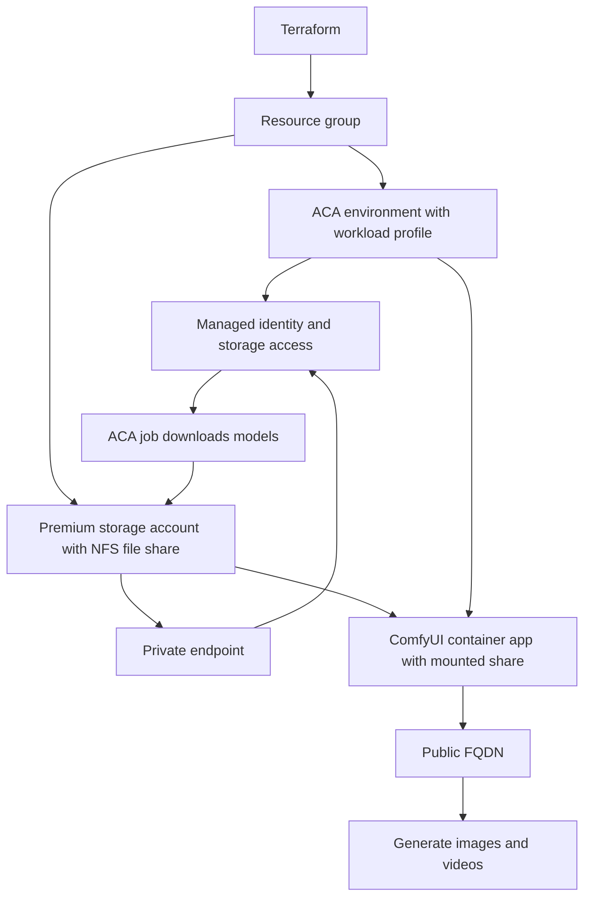

# ComfyUI on Azure Container Apps

## What Is ComfyUI?

ComfyUI is a UI tool for creators who want to generate images, videos and 3D assets without writing code. It uses node-based workflows to chain AI models together, and it produces high-quality content.

It supports GPUs from NVIDIA, AMD, Intel and Apple Silicon, and it works with many different image and video generation models.

It's an open source project, so you can find it here: [ComfyUI on GitHub](https://github.com/comfy-org/comfyui).

## Where Can I Run It?

ComfyUI can run on any VM with a GPU, such as an Azure VM with a GPU. In Azure, I could also host it on:

- Azure Container Apps (ACA)
- Azure Kubernetes Service (AKS)
- Microsoft Foundry
- Azure Machine Learning

For this demo I'm using ACA, because I get a managed container platform with dedicated GPU-capable compute and no cluster to look after.

## Demo: Run ComfyUI on ACA

### Goal

Run ComfyUI as a public web app on ACA, with the model assets stored on a persistent Azure Files share, then test it by generating images and videos.

### High-Level Steps

1. Create the ACA environment.
2. Add a workload profile.
3. Deploy the ComfyUI container image.
4. Download the assets the model needs.
5. Mount Azure Files to the container app.
6. Expose ComfyUI as a public web app.
7. Test by generating images and videos.

### Infrastructure with Terraform

I'm using Terraform to build this, and I'm creating the following resources:

1. **Resource group** to hold everything.
2. **ACA environment** with a workload profile. This gives me dedicated machines, which I need for GPU workloads.
3. **Premium storage account** for file storage. I'm using an Azure Files share with the NFS protocol because it suits Linux containers better than SMB.
4. **Private endpoint** to expose the storage account on a private IP address, so the model files are never reached over the public internet.
5. **Access configuration** to bind the ACA environment to the storage account, including the managed identity access it needs.

### Downloading the Models

The model files are large, so I don't bake them into the image. Instead I run an ACA job that downloads the required model resources and stores them on the Azure Files share. This only needs to run once, and the files persist after that.

### Running the App

Once the models are on the share, I deploy the container app in the workload profile environment with the file share mounted. ComfyUI reads the models from the mount and is exposed through a public FQDN.

## Deployment Flow

## Things to Remember

- The ACA job and the container app both mount the same file share, which is why the models only need to be downloaded once.
- The NFS share requires a premium storage account, and the ACA environment needs network access to the private endpoint.
- Generation is GPU-bound, so the workload profile needs a GPU-capable SKU.
- A public FQDN means anyone with the URL can use ComfyUI, so I should add authentication or restrict access before sharing it.

## Next Steps

- Try different models and workflows to compare image and video quality.
- Watch GPU utilisation and cost, and scale the workload profile to match.
- Put authentication in front of the public endpoint.
