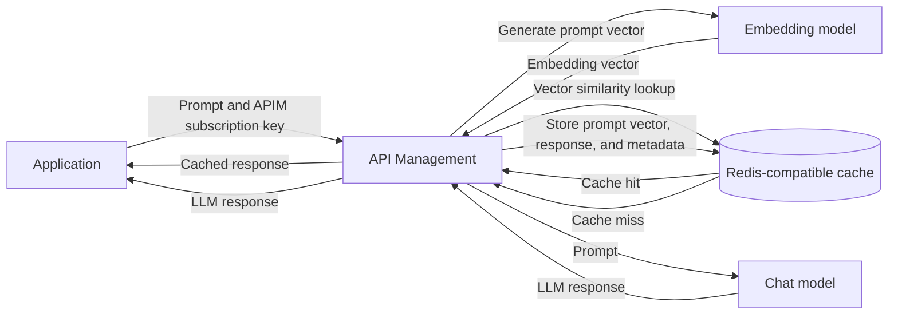

## Basics

Azure API Management (APIM) can act as a GenAI gateway between an application and its backend APIs or LLM endpoints:

```text
Application -> Azure API Management -> Backend API or LLM endpoint
```

This gateway provides standard API management features, including:

* Load balancing across multiple backend or LLM instances
* Authentication using managed identity for backend access, while the application can use an APIM subscription key to call the gateway
* Response caching based on incoming requests
* Request tracing for observability and troubleshooting
* Mock API responses for development and testing
* Logs and metrics through Azure Monitor

These features are configured through APIM policies. The same policy model works for standard REST APIs and LLM APIs. For example, APIM can distribute requests across multiple deployments of the same LLM instead of making the application manage each endpoint directly.

### LLM Capacity Constraints

Each model and Azure region has a limited token capacity. When a deployment reaches its quota or rate limit, requests may be throttled. Several options can help manage this constraint:

* Use pay-as-you-go deployments for consumption-based capacity
* Use Provisioned Throughput Units (PTUs) for reserved model capacity
* Use global deployments or resources where they are supported
* Deploy the model in additional regions
* Configure APIM backend pools with priorities to control which model endpoint receives traffic first
* Use retry or failover policies to detect throttling and route requests to an available deployment in another region

This setup allows the application to use one APIM endpoint while APIM handles the available LLM capacity behind it.

### GenAI Gateway Policies

APIM includes policies that are useful for managing LLM traffic:

* The LLM token limit policy restricts how many tokens a user can consume for a specific model during a defined period
* The LLM metrics policy collects model-specific measurements, including token usage, request counts, latency, and errors
* Standard caching stores a response for a matching prompt, which can include both the user's request and the system message
* Semantic caching stores user requests and LLM responses in a cache such as Azure Managed Redis. An embedding model converts each query into a vector so that APIM can reuse a response for a semantically similar request
* Streaming passes chunks of an LLM response back to the application as the model generates them, instead of waiting for the complete response

For deeper observability, connect APIM to Application Insights and use a Log Analytics workspace to query and analyze its logs, metrics, and traces.

## Connecting API Management

I can use API Management to improve the security, resiliency, and scalability of my API backends. For LLM APIs, Microsoft provides GenAI gateway policies that add controls for authentication, token usage, caching, load balancing, and observability without moving that logic into the application.

## Demo: Connect APIM to Azure OpenAI

In this demo, I use APIM as a GenAI gateway in front of an Azure OpenAI model deployed through Microsoft Foundry. The request flow is:

```text
Application -> APIM GenAI gateway -> Azure OpenAI service
```

The application uses an APIM subscription key to call the gateway. APIM then uses a policy, its system-assigned managed identity, and Azure role-based access control (RBAC) to authenticate to Azure OpenAI. This keeps the Azure OpenAI credentials away from the calling application.

### Create the Azure Resources

1. Create a resource group for the demo resources.
2. Create a Microsoft Foundry resource and open it in the Foundry portal.
3. Deploy a model using the Global Standard deployment type. The deployment provides the project endpoint that APIM will use. For this demo, API-key authentication on the Azure AI service is disabled because APIM will authenticate with Microsoft Entra ID.
4. Create an API Management instance. I use the Consumption tier because it is the cheapest option for this demo.
5. Enable monitoring on APIM so that logs and metrics are available for observability and troubleshooting.
6. Enable the system-assigned managed identity on the APIM instance.
7. Assign the APIM managed identity the `Cognitive Services OpenAI User` role. The assignment can be scoped to the resource group or directly to the Microsoft Foundry resource, depending on how broadly the identity needs access.

### Add the Azure OpenAI API

1. In APIM, add an API and connect it to the Foundry service.
2. Create the connection using Azure AI client compatibility.
3. Provide a suffix for the APIM endpoint. The suffix becomes part of the gateway URL that the application calls.
4. Edit the API's inbound policy so APIM can obtain an authentication token before forwarding the request to Azure OpenAI.

### Configure Managed Identity Authentication

Add the following policy:

```xml
<policies>
    <inbound>
        <base />
        <authentication-managed-identity resource="https://cognitiveservices.azure.com"
            output-token-variable-name="managed-id-access-token" ignore-error="false" />
        <set-header name="Authorization" exists-action="override">
            <value>@("Bearer " + (string)context.Variables["managed-id-access-token"])</value>
        </set-header>
    </inbound>
    <backend>
        <base />
    </backend>
    <outbound>
        <base />
    </outbound>
    <on-error>
        <base />
    </on-error>
</policies>
```

This policy manages backend authentication by using the APIM system-assigned managed identity. The `authentication-managed-identity` policy requests an access token for `https://cognitiveservices.azure.com` and stores it in the `managed-id-access-token` variable. The `set-header` policy then adds that token to the backend request as an `Authorization: Bearer <token>` header. When APIM calls the Foundry-hosted Azure OpenAI service, Azure RBAC checks that the managed identity has the required role.

### Create an APIM Subscription Key

Create a subscription in APIM and copy its primary key for testing. This key authenticates the application to APIM; it is separate from the managed identity token that APIM uses to authenticate to Azure OpenAI.

### Test the Chat Completions Operation

1. Open the API test console and select the `POST` chat completions operation.
2. Set the deployment ID to the name of the deployed LLM model.
3. Set the API version to `2024-05-01-preview`, which is the default version used in this demo.
4. Add the APIM subscription key to the `Ocp-Apim-Subscription-Key` request header. The APIM test console can add this header automatically when it uses the built-in all-access subscription.
5. Keep the `Content-Type` header set to `application/json`.
6. Add the following request body:

```json
{
  "model": "gpt-6-sol",
  "messages": [
    { "role": "system", "content": "You are a helpful assistant" },
    { "role": "user", "content": "How are you?" }
  ],
  "max_completion_tokens": 50
}
```

Send the request. If the APIM subscription, managed identity policy, RBAC assignment, deployment ID, and API version are configured correctly, the request should return `HTTP 200 OK` with the model response.

### Test APIM with Python

The Python scripts show two ways I can test the API through APIM: I can send a direct HTTP request with the Requests library, or I can use the Azure OpenAI Python SDK. Both approaches call the APIM gateway instead of connecting directly to the Azure OpenAI endpoint, and both use the APIM subscription key to authenticate the client to the gateway.

#### Test with a Direct HTTP Request

In `apim.py`, I first construct the chat completions URL by combining the APIM gateway URL with the API route. I then create the request body with the system and user messages and send it with `requests.post`. The APIM subscription key is included in the request headers so APIM can authenticate the request before forwarding it to the Azure OpenAI backend.

After receiving the response, the script checks the HTTP status code and displays whether the request succeeded or failed. For a successful `HTTP 200` response, it loads the response body as JSON, prints the token usage, and reads the generated message from `choices[0].message.content`. If the request fails, it prints the response body to help with troubleshooting.

#### Test with the Azure OpenAI Python SDK

In `openai.py`, I create an `AzureOpenAI` client and use the APIM gateway URL as the Azure endpoint. I also provide the APIM subscription key as the API key and pass the configured API version. This allows the SDK to send requests through APIM while keeping the familiar Azure OpenAI client interface.

I then call `client.chat.completions.create`, provide the deployed model name and conversation messages, and print the generated content from `response.choices[0].message.content`. This approach is useful when I want APIM to remain the gateway while continuing to use the Azure OpenAI SDK in my application code.

## Demo: Load Balance LLM Models with API Management

In this demo, I use APIM to send requests across multiple instances of the same LLM model. APIM acts as the gateway, so the application calls one endpoint while APIM decides which Microsoft Foundry backend should process each request.

```text
Application -> APIM -> Foundry backends in Sweden Central, UK South, and France Central
```

### Why Load Balancing Is Needed

LLM deployments have token and request rate limits. When a deployment reaches its available capacity, Azure OpenAI can throttle additional requests and return an `HTTP 429 Too Many Requests` response. Depending on the workload, I can request a quota increase through Azure support, use pay-as-you-go capacity, purchase Provisioned Throughput Units (PTUs), choose a Global or Data Zone deployment, or create multiple deployments of the same model.

Deploying multiple model instances gives APIM more than one backend to use. These instances can be in the same region or distributed across different regions. If one backend is throttled or unavailable, APIM can retry the request against another backend instead of exposing the failure directly to the application.

### Configure the APIM Backend Pool

I create an APIM backend for each Foundry resource and add those backends to a backend pool. The pool controls how APIM distributes requests by using priorities and weights:

* Priority determines which group of backends APIM tries first. Backends with a lower priority value are preferred, and APIM moves to the next priority group when the preferred group is unavailable.
* Weight controls how traffic is distributed between backends that have the same priority. A backend with a higher weight receives a larger share of the requests.
* When backends have the same priority and equal weights, requests are distributed evenly, which provides round-robin-style load balancing.

For this demo, all three Foundry backends have the same priority but different weights. This keeps them in the same active group while allowing me to direct more traffic to the backends with greater available capacity.

## Create an APIM backend for Azure AI Foundry models

1. In **API Management**, go to **Backends** → **+ Add**.

2. Use these backend values:

| Field | Value |
|---|---|
| **Name** | Something clear, e.g. `foundry-models-backend` |
| **Description** | Optional, e.g. `Azure AI Foundry model endpoint` |
| **Backend hosting type** | `Custom URL` |
| **Runtime URL** | Your Foundry root endpoint, e.g. `https://apilaboa01.services.ai.azure.com` |

Do **not** include paths like `/models`, `/openai/v1`, `/chat/completions`, `/embeddings`, or deployment names in the backend Runtime URL.

3. Under **Authorization credentials**, enable **Managed identity**.

4. Use:

| Field | Value |
|---|---|
| **Client identity** | `System assigned identity` |
| **Resource ID** | `https://cognitiveservices.azure.com` |

5. Make sure the APIM system-assigned identity has the **Cognitive Services User** role on the Azure AI Foundry / Azure AI Services resource.

6. In your API policy, route traffic to this backend:

```xml
<set-backend-service backend-id="foundry-models-backend" />
```

In simple terms: the **backend** is the real Foundry service APIM forwards requests to. The **Runtime URL** is the base address of Foundry, while each APIM operation adds the specific path such as chat completions or embeddings.

### Deploy the Architecture with IaC

The IaC for this demo is intended to deploy one APIM instance and three Microsoft Foundry resources across Sweden Central, UK South, and France Central. Each Foundry resource hosts an instance of the same LLM model and is registered as an APIM backend. APIM then exposes a single gateway endpoint to the application and handles weighted traffic distribution, retries, and failover behind that endpoint.

## Demo: Semantic Caching

In this demo, I use APIM semantic caching to store and reuse responses from an LLM. The application continues to call one APIM endpoint, while APIM checks a Redis-compatible cache before sending the request to the chat model.

### Why Use Semantic Caching

LLM requests can be expensive because each call consumes tokens, and responses can take several seconds while the user waits. Users may also ask the same question in different ways and receive almost the same answer. Reusing a suitable cached response can reduce model calls and token costs, lower response latency, improve the user experience, and reduce pressure on the backend model.

Unlike a standard cache that normally requires an exact key match, a semantic cache can match prompts that have similar meanings. An embedding model converts the incoming prompt into a vector, and APIM uses vector search to compare it with prompt vectors already stored in Redis.

### Semantic Cache Request Flow



For each eligible request, APIM creates an embedding and searches the external Redis cache. If it finds a sufficiently similar entry, APIM returns the cached response without calling the chat model. If there is no acceptable match, APIM sends the request to the chat model and stores the resulting response so it can be reused later.

### Configure the Cache Behavior

APIM provides the `llm-semantic-cache-lookup` policy for checking the cache during inbound processing and the `llm-semantic-cache-store` policy for storing eligible responses during outbound processing. Both policies are required for the complete lookup-and-store flow.

The cache lookup considers the conversation content, which can include the user prompt and system message depending on the policy configuration. The stored entry contains the data APIM needs to associate the prompt embedding with the LLM response and related metadata.

The `score-threshold` setting controls how similar an incoming prompt must be to a cached prompt. APIM accepts values from `0.0` to `1.0`, and a lower value requires a closer semantic match. I should begin with a strict threshold and loosen it only after confirming that the reused responses remain accurate.

The `duration` setting on the store policy defines how long a cached response remains available and is expressed in seconds. Stable answers can use a longer duration, while frequently changing or time-sensitive information should use a shorter duration. Because semantic matches are not exact matches, I should avoid reusing responses across users or tenants without partitioning the cache, for example by using `<vary-by>` with the APIM subscription or another appropriate boundary.

### Resources Needed

#### API Management

* Enable a managed identity and connect APIM to the Microsoft Foundry model endpoints.
* Create an APIM subscription key for the application calling the gateway.
* Create a backend for the embeddings deployment and specify its full embeddings URL.
* Configure the Redis connection in the APIM **External cache** settings. If Redis runs in Azure Container Apps, APIM connects to the reachable Redis endpoint; the connection string is not configured on the container app itself.
* Add the semantic cache lookup policy to inbound processing and the semantic cache store policy to outbound processing.
* Configure managed identity authentication so APIM can call both the chat model and embedding model without storing their API keys.

#### Redis-Compatible Cache

APIM requires an external Redis-compatible cache with RediSearch vector-search support. Azure Managed Redis can provide this capability, but I cannot create the enterprise Redis option in my current MCAPS environment. As an alternative, I can deploy a Redis Stack container to AKS or Azure Container Apps. For Azure Container Apps, I need to create a Container Apps environment, deploy the Redis Stack image, and configure the required virtual network and subnet so APIM can reach the cache securely.

#### Microsoft Foundry

I need both a chat model deployment for generating responses and an embedding model deployment for converting prompts into vectors. The same embedding model and vector dimensions must be used consistently when storing and looking up cache entries.

### Test Semantic Caching

To test the setup, I open the Chat Completions operation in the APIM test console and provide the subscription key, deployment details, API version, and request body as configured earlier. I first send a prompt to create a cache entry, then send the same prompt or a semantically similar prompt. APIM tracing should show whether the second request produced a cache hit or continued to the LLM backend. I can then adjust the score threshold and cache duration based on the results.
