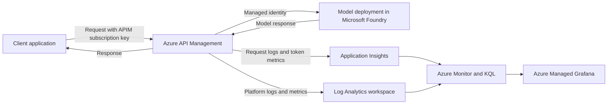

## Why I Collect APIM Logs and Metrics

Collecting logs and metrics from Azure API Management helps me understand how an Azure OpenAI model is being used and provides accurate data for cross-charging and chargeback. When several teams or applications share the same model deployment, I can use token consumption and request metadata to identify which team generated the usage and allocate the cost correctly.

APIM provides platform metrics and diagnostic logs by default, but Azure OpenAI workloads need additional telemetry to capture token usage. I use the `azure-openai-emit-token-metric` APIM policy to emit token metrics and add dimensions that make the data easier to filter and group.

In this example, I collect the following dimensions:

* APIM subscription ID
* Client IP address
* API ID
* User ID from the `x-user-id` request header

## Telemetry Flow

The client sends a request through APIM, and APIM authenticates to the model endpoint by using its managed identity. The custom policy emits Azure OpenAI token metrics to Application Insights, while APIM diagnostic settings send the available platform logs and metrics to the Log Analytics workspace. I can then use Azure Monitor and KQL to analyse the telemetry and display it in dashboards or workbooks.

## What I Can Analyse

I can use Kusto Query Language (KQL) to query custom token metrics and inspect the requests served through APIM. Depending on the diagnostic configuration, the request records can include the system prompt, user prompt, completion, client details, API details, and the number of tokens consumed.

> [!CAUTION]
> Prompt and completion bodies can contain sensitive or personal information. In this demo, APIM logs up to 8,192 bytes from the frontend and backend request and response bodies with 100% diagnostic sampling. I would reduce or disable body logging, apply appropriate sampling and retention, and restrict access to the telemetry before using this configuration in production.

The collected data can help me answer questions such as:

* Which APIM subscription, application, or user consumes the most tokens?
* How many requests does each API serve?
* Which requests fail, and where does the failure occur?
* What are the request latency and model response times?
* How does token usage change over time?

## Demo Resources

The demo uses the following Azure resources and configuration:

* A resource group for the complete deployment
* An APIM instance on the Consumption tier
* A system-assigned managed identity for APIM
* The **Cognitive Services OpenAI User** role, which allows APIM to call the model deployment in Microsoft Foundry
* The **Monitoring Metrics Publisher** role, which allows APIM to publish custom metrics to Application Insights
* An Azure OpenAI API imported into APIM from an OpenAPI specification; I can also connect an existing API from the APIM API inventory
* An active APIM subscription and subscription key for controlling and attributing client access
* A Microsoft Foundry resource with an LLM model deployed by using the Global Standard deployment type
* An Application Insights resource linked to a Log Analytics workspace
* An APIM logger that connects APIM to Application Insights
* APIM diagnostics that send request telemetry to Application Insights
* APIM resource diagnostic settings that send platform logs and metrics to Log Analytics
* Custom metric dimensions enabled with `CustomMetricsOptedInType` set to `WithDimensions`
* An Application Insights workbook for analysing OpenAI usage
* Azure Managed Grafana for visualising Azure Monitor data in dashboards

## Deploy and Test the Demo

I can deploy the resources by running Terraform from the `IAC` folder. The configuration creates the Foundry model deployment, APIM API and policy, monitoring resources, workbook, role assignments, diagnostic settings, and Azure Managed Grafana instance.

After the deployment completes, I generate traffic by sending model requests through the APIM endpoint with the APIM subscription key. I can also include an `x-user-id` header when I want the custom token metric to identify a specific user; if the header is missing, the policy records the user dimension as `N/A`.

Once traffic has been generated, I use KQL in Application Insights or the Log Analytics workspace to inspect the requests, custom metrics, token usage, failures, and latency. I can then build visualisations in Azure Managed Grafana, or use another Grafana deployment, by connecting it to Azure Monitor and presenting the queried metrics in dashboards.
