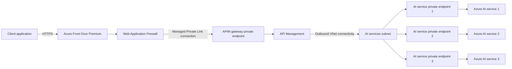
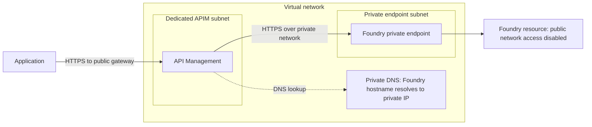

# APIM Networking

## Private Connectivity with foundry

Customers can establish private connectivity for Azure AI services by using Azure API Management, Azure Front Door Premium, virtual networks, private endpoints, and Azure Private Link. In this design, the AI resources and APIM gateway are not directly exposed to clients. Azure Front Door is the only public entry point and provides global routing and Web Application Firewall (WAF) protection before forwarding traffic to APIM.

### Architecture Flow



### Keep the AI Services Private

Customers deploy there Azure AI services with public network access disabled, in multiple regions. Each service receives a private endpoint with a private IP address from a dedicated subnet in my virtual network, allowing traffic to reach the service over the Microsoft backbone instead of the public internet. 

They can configure private DNS so the normal Azure AI service hostnames resolve to the correct private IP addresses from within the virtual network.

### Connect API Management to the AI Services

I configure APIM with supported outbound virtual network connectivity so it can resolve and reach the private endpoints. APIM should use its own delegated or dedicated subnet where required, while the AI service private endpoints remain in a separate subnet in the same virtual network or in a peered virtual network.

Because APIM has private network connectivity to the AI service endpoints (because they APIM and AI service Private endpoints are in the same VNet), it can route requests to those backends without exposing them publicly. I can use APIM backend pools and policies to assign priorities and weights to the endpoints for load balancing, failover, or traffic distribution.

Can also access APIM withing the same VNET. By creating another subnet for a VM and accessing the APIM through a second private enpoint in the same subnet. Allowing the VM to connect using the private endpoint.

### Connect Azure Front Door to API Management

APIM still has a gateway FQDN that Azure Front Door uses as the origin host. In Azure Front Door Premium, I add the APIM instance to an origin group, select the **Gateway** subresource, and enable Private Link for the origin. Azure Front Door then creates a managed private endpoint from a Microsoft-managed regional virtual network and sends a private endpoint connection request to APIM.

I approve the pending connection under the APIM inbound private endpoint settings. After the connection is established, Azure Front Door can send requests privately to the APIM gateway. I can then disable APIM public network access so clients cannot bypass Azure Front Door and call the APIM gateway directly.

> [!IMPORTANT]
> This direct Private Link integration requires Azure Front Door Premium. I also need to verify that my APIM tier supports the networking combination I plan to use. In classic APIM tiers, inbound private endpoints are not supported when the instance is injected into an internal or external virtual network. Standard v2 and Premium v2 support inbound private endpoints with their supported virtual network configurations, which makes it possible to combine a private Front Door origin with outbound connectivity to private backends.

### End-to-End Request Path

The final request path is:

```text
Client -> Azure Front Door Premium + WAF -> Private Link -> API Management -> Private endpoint -> Azure AI service
```

Azure Front Door acts as the public endpoint for the client application and provides global reach and request inspection through WAF. APIM remains the policy and routing layer, while the AI services remain private and can only be reached through their private endpoints.

## Connect APIM to AI services behind private endpoints

When I expose a model through APIM, I want applications to call the gateway rather than connect directly to the model. A private endpoint helps me make the connection from APIM to Foundry private.

A **private endpoint (PE)** gives the Foundry resource a private IP address in my virtual network (VNet). Once I disable public network access on Foundry, model requests must use an approved private endpoint instead of the public network path.

Creating a private endpoint does **not** disable public access automatically. I need to configure both.

### What does the request path look like?

For this example, I use a classic Developer or Premium APIM instance injected into a VNet in **external mode**. Applications can still reach APIM's public HTTPS gateway, but APIM reaches Foundry through a private endpoint.



The Foundry service itself is not deployed inside my subnet. Its private endpoint is the network interface that lets APIM reach it privately.

> [!IMPORTANT]
> Making Foundry private does not make APIM's gateway private. External-mode APIM still accepts public client traffic. The Front Door design in the previous section adds a separate private inbound connection to APIM and requires a compatible APIM tier and networking configuration.

### Step 1: Create the VNet and separate subnets

I start by creating a VNet with:

- **An APIM subnet:** Dedicated to the APIM instance.
- **A private endpoint subnet:** Used for the Foundry private endpoint.

Using separate subnets makes the networking requirements and access rules easier to manage. APIM and the private endpoint do not need to be in the same subnet.

I can also place them in peered VNets, provided routing, DNS, and network rules allow the connection. For this walkthrough, using separate subnets in one VNet is simpler.

### Step 2: Create Foundry and its private endpoint

1. Create the Foundry resource and deploy the model.
2. Open the resource's **Networking** settings and create a private endpoint.
3. Select the Foundry account as the target resource:
   - **Resource type:** `Microsoft.CognitiveServices/accounts`
   - **Target subresource:** `account`
4. Select my VNet and the private endpoint subnet.
5. Enable private DNS integration for the required service endpoints.
6. Complete the deployment and confirm that the private endpoint connection is **Approved**.

This example targets the Foundry account resource, not a separate project, hub, or individual model deployment.

### Step 3: Configure private DNS

APIM should continue using the normal Foundry backend hostname, such as:

```text
https://<resource-name>.openai.azure.com
```

Private DNS makes that hostname resolve to the private endpoint's IP address from the network APIM uses. I do **not** replace the backend URL with a raw private IP address; keeping the hostname preserves the correct HTTPS certificate validation and service routing.

For `Microsoft.CognitiveServices/accounts`, the documented private DNS zones are:

| Service endpoint | Private DNS zone |
| --- | --- |
| Azure OpenAI | `privatelink.openai.azure.com` |
| Azure AI services | `privatelink.cognitiveservices.azure.com` |
| Foundry services | `privatelink.services.ai.azure.com` |

I check the private endpoint's DNS configuration to confirm which zones and records the resource needs, then link those zones to the VNet where APIM resolves DNS.

If I use peered VNets, peering alone does not make private DNS zones available to both networks. I need the appropriate VNet links or a shared DNS resolver. Custom DNS servers also need forwarding configured for private endpoint resolution.

### Step 4: Give APIM outbound access to the VNet

For the classic APIM setup shown here:

1. Create or select a **Developer** or **Premium** APIM instance.
2. Open its virtual network settings and select **External** mode.
3. Attach it to the dedicated APIM subnet.
4. Create and associate a network security group (NSG) with that subnet.
5. Configure the required APIM network rules, including DNS resolution and HTTPS access to the Foundry private endpoint.
6. Wait for the networking update to complete.

The NSG must also allow APIM's required management and service dependencies. Blocking everything except Foundry can prevent APIM from operating correctly. Follow the [APIM subnet and network requirements](https://learn.microsoft.com/en-us/azure/api-management/virtual-network-injection-resources) rather than adding only one outbound rule.

> [!NOTE]
> VNet injection is not the only option. Standard v2 and Premium v2 support outbound VNet integration, with different subnet requirements. An inbound private endpoint on APIM does not provide outbound connectivity to Foundry by itself. Choose the networking option supported by the tier using the [APIM networking comparison](https://learn.microsoft.com/en-us/azure/api-management/virtual-network-concepts).

### Step 5: Configure the API and managed identity

Private networking controls how APIM reaches Foundry. It does not replace authentication.

1. Enable APIM's system-assigned managed identity.
2. Assign that identity the **Cognitive Services OpenAI User** role on the Foundry resource for this Azure OpenAI example.
3. Add the Foundry model API to APIM, using its normal hostname as the backend URL.
4. Create an APIM subscription for the API.
5. Configure the API policy to authenticate backend requests using APIM's managed identity.

For the authentication policy and a fuller explanation, follow the [APIM authentication walkthrough](../OpenAI_Aunthentication/notes.md). Role assignments can take time to propagate.

### Step 6: Disable Foundry's public network access

Once the private endpoint, DNS, and APIM connectivity are configured:

1. Open the Foundry resource's **Networking** settings.
2. Set **Public network access** to **Disabled**.
3. Save the change and confirm that the approved private endpoint remains available.

This blocks the public data-plane path; it does not delete the service hostname. APIM still uses that hostname, but DNS resolves it to the private IP from the connected network.

Tools that call the model directly, including portal testing experiences, also need an allowed private network path. My laptop does not gain access just because I created the private endpoint.

### Step 7: Test the private connection

I check both the allowed path and the path I intended to block:

1. From a test machine using the same DNS setup as APIM, resolve the Foundry hostname and confirm that it returns the private endpoint's IP address.
2. Send a model request through APIM and confirm that it succeeds with Foundry's public network access disabled.
3. Use APIM tracing to check backend errors if the request fails.
4. From outside the private network, try a direct model request using otherwise valid authentication. Confirm that public network access is denied.

A DNS test from another machine is useful, but it does not prove APIM uses the same resolver. The successful end-to-end APIM request is the important check.

If the request fails, I check private endpoint approval, DNS resolution, NSG rules, routes, and managed identity permissions. A `401` or `403` response can indicate an authentication or access-policy problem, not just a network problem.

The result is a model backend that APIM can reach privately, while applications continue using the gateway as their entry point.

## Demo

Deploy RG
deploy foundry in 3 different regions
deploy model
