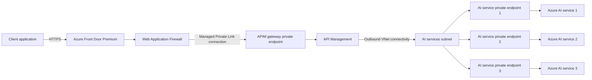

# APIM Networking

## Private Connectivity with foundry

I can establish private connectivity for Azure AI services by using Azure API Management, Azure Front Door Premium, virtual networks, private endpoints, and Azure Private Link. In this design, the AI resources and APIM gateway are not directly exposed to clients. Azure Front Door is the only public entry point and provides global routing and Web Application Firewall (WAF) protection before forwarding traffic to APIM.

### Architecture Flow



### Keep the AI Services Private

I deploy the Azure AI services with public network access disabled, in multiple regions. Each service receives a private endpoint with a private IP address from a dedicated subnet in my virtual network, allowing traffic to reach the service over the Microsoft backbone instead of the public internet. I also configure private DNS so the normal Azure AI service hostnames resolve to the correct private IP addresses from within the virtual network.

### Connect API Management to the AI Services

I configure APIM with supported outbound virtual network connectivity so it can resolve and reach the private endpoints. APIM should use its own delegated or dedicated subnet where required, while the AI service private endpoints remain in a separate subnet in the same virtual network or in a peered virtual network.

Because APIM has private network connectivity to the AI service endpoints (because they APIM and AI service Private endpoints are in the same VNet), it can route requests to those backends without exposing them publicly. I can use APIM backend pools and policies to assign priorities and weights to the endpoints for load balancing, failover, or traffic distribution.

Can also access APIM withing the same VNET. By creating another subnet for a VM and accessing the APIM through a second private enpoint in the same subnet. Allowing the VM to connect using the private endpoint.

### Connect Azure Front Door to API Management

APIM still has a gateway FQDN that Azure Front Door uses as the origin host. In Azure Front Door Premium, I add the APIM instance to an origin group, select the **Gateway** subresource, and enable Private Link for the origin. Azure Front Door then creates a managed private endpoint from a Microsoft-managed regional virtual network and sends a private endpoint connection request to APIM.

I approve the pending connection under the APIM inbound private endpoint settings. After the connection is established, Azure Front Door can send requests privately to the APIM gateway. I can then disable APIM public network access so clients cannot bypass Azure Front Door and call the APIM gateway directly.

> [!IMPORTANT]
> This direct Private Link integration requires Azure Front Door Premium. I also need to verify that my APIM tier supports the networking combination I plan to use. In classic APIM tiers, inbound private endpoints are not supported when the instance is injected into an internal or external virtual network. Standard v2 and Premium v2 support inbound private endpoints with their supported virtual network configurations, which makes it possible to combine a private Front Door origin with outbound connectivity to private backends.

### End-to-End Request Path

The final request path is:

```text
Client -> Azure Front Door Premium + WAF -> Private Link -> API Management -> Private endpoint -> Azure AI service
```

Azure Front Door acts as the public endpoint for the client application and provides global reach and request inspection through WAF. APIM remains the policy and routing layer, while the AI services remain private and can only be reached through their private endpoints.

## Demo

Deploy RG
deploy foundry in 3 different regions
deploy model
