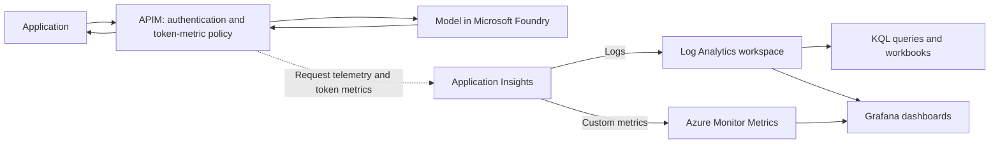

# Observe LLM usage with Azure API Management

When we build an application that calls an LLM, getting a response is only part of the story. We also need to understand what happens when people use it. How long do requests take? Which requests fail? How many tokens are different applications consuming?

This is where **observability** helps. We collect logs and metrics so we can see how the application behaves, investigate problems, and understand usage instead of guessing.

In this walkthrough, we will connect Azure API Management (APIM) to Application Insights, use a policy to emit token metrics, and query request logs with Kusto Query Language (KQL). We can then use workbooks or Grafana to turn that data into dashboards.

## What are we trying to understand?

There are two main types of data we will use:

- **Logs:** Records of individual events, such as a request's status, duration, and the API it reached. These help us investigate what happened.
- **Metrics:** Numeric measurements over time, such as token consumption. These help us spot trends and compare usage.

Together, they can help us answer questions like:

- Which applications are making the most requests?
- Are responses getting slower?
- How often are requests failing or being throttled?
- How many prompt and completion tokens are being consumed?
- How is usage split between teams sharing the same model?

Token usage can help us estimate model costs, but it is not the same as an invoice. Remaining-token allowance is also a separate concept: emitting a token metric does not enforce a limit or calculate a user's remaining allowance.

## How the pieces fit together

APIM sits between the application and the model. It forwards requests to Foundry and sends request telemetry and token metrics to Application Insights.

Application Insights is linked to a Log Analytics workspace, where its logs are stored. We use KQL to query those logs, and dashboards to visualize the results. Custom token metrics are also available through Azure Monitor's metrics experience.



There are two different monitoring connections to keep in mind:

1. **APIM's Application Insights logger and API diagnostic:** Collect telemetry for requests through the gateway and enable custom token metrics.
2. **Azure resource diagnostic settings:** Send platform logs and metrics from APIM or Foundry to a destination such as Log Analytics.

Sending Foundry diagnostics to the same workspace does not automatically configure APIM's logger. We need to set up the gateway connection separately.

## Before you start

You will need:

- An Azure subscription and permission to create resources and assign roles.
- An APIM instance and a model deployment in Microsoft Foundry.
- A working model API exposed through APIM.
- A Log Analytics workspace and a workspace-based Application Insights resource.
- Access to read telemetry in Application Insights and Log Analytics.
- Terraform if you want to use the infrastructure included in this folder.

Start with non-streaming chat completion requests. Token reporting depends on the API and the usage information returned by the model; streaming and interrupted responses need additional testing.

## Step 1: Confirm that requests work through APIM

Before adding monitoring, make sure we can call the model successfully through the gateway.

1. Create APIM and deploy the model in Foundry if you have not already done so.
2. Enable APIM's system-assigned managed identity.
3. Give that identity the **Cognitive Services OpenAI User** role on the Foundry resource.
4. Add the model API to APIM and configure its backend endpoint.
5. Create an APIM subscription for the API and obtain its subscription key.
6. Use the API's **Test** tab in APIM to send a chat completion request and confirm that it succeeds.

The application authenticates to APIM using the subscription key. APIM uses its managed identity to authenticate to Foundry. These are separate connections with different credentials.

If you need more detail on this setup, follow the [APIM authentication walkthrough](../OpenAI_Aunthentication/notes.md).

## Step 2: Create Application Insights and its workspace

Create a Log Analytics workspace, then create a workspace-based Application Insights resource linked to it.

The [Application Insights module](IAC/modules/App_insight/main.tf) handles this for the Terraform path. It creates:

- A `PerGB2018` Log Analytics workspace.
- A workspace-based Application Insights component of type `web`.
- A default retention period of 30 days.

Think of Application Insights as the application monitoring experience, and Log Analytics as the place where we store and query its logs.

If you also want Foundry platform diagnostics, open the Foundry resource in the Azure portal:

1. Go to **Monitoring > Diagnostic settings**.
2. Add a diagnostic setting.
3. Select the supported log and metric categories you need.
4. Choose **Send to Log Analytics workspace** and select the workspace linked to Application Insights.
5. Save the setting.

This is an additional connection. The included observability module configures APIM platform diagnostics, not Foundry diagnostic settings.

## Step 3: Connect APIM to Application Insights

APIM needs a **logger** that identifies the Application Insights destination, then an **API diagnostic** that tells it what to collect.

For the managed identity setup used here:

1. Assign APIM's managed identity the **Monitoring Metrics Publisher** role, scoped to the Application Insights resource.
2. Create an Application Insights logger in APIM using the component's connection string and APIM's system-assigned identity.
3. Open the model API in APIM and enable Application Insights logging in its diagnostic settings.
4. Select the logger, use **100% sampling** for the initial test, and enable **Always log errors**.
5. Leave request/response body capture, header capture, and client IP logging disabled.

The Terraform module creates this connection and disables local ingestion authentication on Application Insights. The portal's instrumentation-key connection is not equivalent to this managed identity setup; use Terraform or the documented REST configuration for the logger.

The module also routes APIM platform logs and metrics to the workspace using resource-specific tables. Those tables are separate from Application Insights request telemetry.

> [!IMPORTANT]
> Prompts, responses, and headers can contain private data or credentials. We do not need to log their contents just to measure request duration, failures, or token consumption. Only enable additional capture when there is a clear need and appropriate access, retention, and privacy controls.

## Step 4: Enable custom metrics and add the token policy

Request logging alone does not enable custom token metrics. We also need to:

1. Enable custom metrics **With dimensions** in Application Insights.
2. Set `metrics = true` on APIM's Application Insights API diagnostic.
3. Add the token-metric policy inside the API's `inbound` section.

A **dimension** is a label attached to a metric. For example, a subscription ID lets us group token usage by APIM subscription.

The [checked-in policy](policy/policy.xml) uses:

```xml
<azure-openai-emit-token-metric namespace="openai">
    <dimension name="Subscription ID" value="@(context.Subscription.Id)" />
    <dimension name="Client IP" value="@(context.Request.IpAddress)" />
    <dimension name="API ID" value="@(context.Api.Id)" />
    <dimension name="User ID" value='@(context.Request.Headers.GetValueOrDefault("x-user-id", "N/A"))' />
</azure-openai-emit-token-metric>
```

Keep the existing authentication and routing policies when adding this block. Although it is declared in `inbound`, the token policy uses the model response's usage information when available.

Here is what the configured dimensions mean:

| Dimension | What it represents | What to keep in mind |
| --- | --- | --- |
| Subscription ID | The APIM subscription making the request | A subscription can represent an application or team, but is not necessarily one person. |
| Client IP | The client address APIM sees | Shared networks and proxies can give multiple users the same address. |
| API ID | The API receiving the request | Useful for comparing APIs exposed by the gateway. |
| User ID | The value supplied in `x-user-id`, or `N/A` if absent | It is caller-controlled in this demo, not a verified user identity. |

The policy does not validate `x-user-id`. Do not use it as trusted evidence for billing or authorization. For reliable attribution, derive identifiers from validated identities or controlled subscription mappings.

> [!NOTE]
> The repository uses `azure-openai-emit-token-metric`. Current Microsoft Learn documentation uses the broader `llm-emit-token-metric` name. Check the [policy reference](https://learn.microsoft.com/en-us/azure/api-management/llm-emit-token-metric-policy) for your gateway and model API before adapting the example.

### Keep dimensions useful and manageable

More labels do not always mean better monitoring. A metric with many distinct users and IP addresses can create many separate time series. This is called **high cardinality**, and it can increase cost or reach monitoring limits.

The current policy reference documents limits of 100 unique values per dimension and 1,000 active time series per metric namespace in APIM. New values beyond those limits can be discarded. Review the current limits and choose dimensions carefully before production use.

Disabling client IP logging in the API diagnostic does not remove the `Client IP` dimension from this policy. They are separate settings.

## Step 5: Send requests and check the telemetry

Send a few successful requests through APIM, then allow time for telemetry ingestion.

The folder includes [an HTTP request script](logs_apim.py) and [an SDK example](logs_sdk.py). Check their routes before using them: they currently target a `/models/chat/completions` API, while the Terraform APIM configuration exposes the Azure OpenAI API under `/openai`, with deployment-based operations. They are not interchangeable without adjusting the request configuration.

For the initial Terraform test, use APIM's **Test** tab and the imported chat completions operation. Supply the deployment name, a supported API version, the subscription key, and a non-streaming request body.

> [!WARNING]
> The SDK example prints its subscription key. Do not use its output in shared terminals, recordings, or logs without removing that credential output first.

Once requests succeed:

1. Open **Application Insights > Logs** and select KQL mode.
2. Choose a time range that includes your test.
3. Run the request query below to confirm that telemetry arrived.
4. Open **Application Insights > Metrics**, select the `openai` custom namespace, and inspect the available token metrics.
5. Use **Sum** to view token consumption over the selected period, and split by a configured dimension such as `Subscription ID`.

Token metrics and request logs are different views of the request flow. Do not assume the token policy adds every metric dimension to the `requests` table.

## Step 6: Query request logs with KQL

Start with a query that works without capturing bodies or headers:

```kql
requests
| where timestamp > ago(1h)
| extend apiName = tostring(customDimensions["API Name"])
| extend apimSubscription = tostring(customDimensions["Subscription Name"])
| project timestamp, name, apiName, apimSubscription,
    durationMs = round(duration, 2), resultCode, success, operation_Id
| order by timestamp desc
| take 100
```

This shows recent requests, their duration in milliseconds, status, and operation ID. The operation ID helps us correlate a request with related telemetry. Inspect `customDimensions` on an actual record if the API or subscription fields are empty; property availability depends on the telemetry configuration.

The query uses the Application Insights `requests` schema. If you open **Logs** directly on the workspace, the equivalent table is `AppRequests`, with names such as `TimeGenerated`, `DurationMs`, and `Properties`. APIM platform logs use their own resource-specific tables, so select the table that matches the data you want to inspect.

### Look for trends rather than individual requests

To see request volume, failures, and latency over time:

```kql
requests
| where timestamp > ago(24h)
| summarize
    recordedRequests = count(),
    recordedFailures = countif(success == false),
    averageDurationMs = avg(duration),
    p95DurationMs = percentile(duration, 95)
    by bin(timestamp, 15m)
| order by timestamp asc
```

The **95th percentile**, or p95, helps us see how slow requests near the slower end of the distribution are. It is often more useful than an average alone.

These counts describe recorded telemetry. If we reduce sampling, a row count is not the total number of actual requests. Sampling-aware analysis needs to account for telemetry weights such as `itemCount`.

### What about model details and remaining tokens?

The original idea was to extract the model, prompt, answer, token usage, and remaining allowance from logged bodies and headers. Those fields are not collected by this Terraform configuration.

If you deliberately enable capture for a controlled test, you can inspect response usage like this:

```kql
requests
| where timestamp > ago(1h)
| extend responseBody = parse_json(tostring(customDimensions["Response-Body"]))
| extend promptTokens = tolong(responseBody.usage.prompt_tokens)
| extend completionTokens = tolong(responseBody.usage.completion_tokens)
| extend totalTokens = tolong(responseBody.usage.total_tokens)
| project timestamp, name, promptTokens, completionTokens, totalTokens
| order by timestamp desc
| take 100
```

This example assumes a complete, logged chat completion response with a `usage` object. Missing or truncated bodies can produce empty fields. Prefer the token-metric policy for routine monitoring instead of logging full responses just to count tokens.

Likewise, fields such as `Response-x-ms-region`, `Response-x-ratelimit-remaining-tokens`, and `Response-x-ratelimit-remaining-requests` require the backend to return those headers and APIM to capture them. Backend rate-limit headers describe the backend's allowance, not automatically a per-user budget in APIM. For gateway-level token controls, see the [token limit walkthrough](../Token_Limit/notes.md).

## Step 7: Build a workbook or Grafana dashboard

Once the queries return useful data, we can turn them into a reusable dashboard.

For an Azure workbook:

1. Open **Workbooks** in Application Insights or Azure Monitor.
2. Create a workbook and add a query using the correct resource or workspace scope.
3. Add charts for request volume, failures, and latency.
4. Add token consumption views using the custom metrics source.
5. Add filters for time range, API, and subscription where the data supports them.
6. Save it somewhere the intended team can access.

The [Grafana module](IAC/modules/Grafana/main.tf) provides another option. It creates Azure Managed Grafana with:

- The `Standard` SKU and major version `11` by default.
- Public access authenticated through Microsoft Entra ID.
- API keys disabled.
- A managed identity with **Monitoring Reader** on this resource group, not the entire subscription.
- **Grafana Admin** assigned to the configured administrator.

After deployment, open the `grafana_endpoint` output and configure the Azure Monitor data source or import a dashboard using the actual subscription, APIM resource, and workspace. Terraform does not automatically import dashboards or run an Azure CLI provisioner.

For CI deployments, set `grafana_admin_object_id` to the Entra object ID of the user or group that should administer Grafana. Otherwise, the deployment identity receives the administrator role by default.

### Use token data for cost estimates, not final billing

If several teams share a model, we can map controlled APIM subscriptions to teams and compare consumption. A basic model cost estimate is:

```text
Estimated model cost =
    (prompt tokens / pricing unit) x input token price
    + (completion tokens / pricing unit) x output token price
```

Use the actual deployment's pricing unit and rates, and handle cached or other token categories separately where applicable. This estimate does not include APIM, monitoring, Grafana, or other infrastructure costs.

For chargeback, reconcile the result with Azure billing and account for missing telemetry, retries, sampling, and traffic that bypasses APIM. Metric values alone are not an authoritative billing ledger.

## Terraform settings you can override

The [root configuration](IAC/main.tf) passes resource IDs and settings between the modules. Each module keeps resources in its main file, typed inputs in its variable file, and outputs in its output file.

| Input | Default or purpose |
| --- | --- |
| `app_insights_name` | Defaults to `app-insights-<prefix>`. |
| `log_analytics_name` | Defaults to `log-observability-<prefix>`. |
| `grafana_name` | Defaults to `grafana-<prefix>`. |
| `observability_retention_in_days` | Defaults to `30`. |
| `apim_sampling_percentage` | Defaults to `100`; consider reducing it for high traffic. |
| `grafana_major_version` | Supports `11` and `12`; confirm regional availability and lifecycle support. |
| `grafana_admin_object_id` | An Entra object ID, not an application client ID. |

The API diagnostic uses AzAPI because AzureRM 4.81 does not expose its custom-metrics `metrics` property. Its JSON configuration uses `jsonencode` for compatibility with this stack's AzAPI 1.x provider.

The root exports monitoring resource IDs, names, the Grafana endpoint, and a sensitive Application Insights connection string. Sensitive outputs still exist in Terraform state, so restrict access to the state backend.

## Validate the infrastructure without deploying

From the repository root:

```powershell
Set-Location .\APIM\Observability\IAC
terraform init -backend=false
terraform fmt -check -recursive
terraform validate
terraform test
```

For focused checks, run the same Terraform commands from the [Application Insights module](IAC/modules/App_insight) or [Grafana module](IAC/modules/Grafana). Terraform 1.7 or later is required for mocked providers.

The [validation workflow](../../.github/workflows/observability-terraform.yml) runs these checks in all three directories on relevant pull requests, matching pushes to `main`, and nightly. It also checks that the policy XML parses.

Mocked tests verify configuration wiring, role scopes, sampling, and custom-metric settings. They do not prove live ingestion, dashboard queries, effective permissions, or regional availability. Use the request and telemetry checks above after deployment.

Before a real deployment, authenticate to Azure, initialize **without** `-backend=false`, and review `terraform plan`. The root configuration also includes Redis resources; check the whole plan rather than assuming this stack creates monitoring resources only.

> [!IMPORTANT]
> Give this stack a dedicated backend state key. The copied provider configuration uses `apim.tfstate`, which must not be shared with other independent APIM stacks.

## If telemetry does not appear

Check these in order:

1. **Request path:** Did the request actually pass through the APIM API whose diagnostic and policy you configured?
2. **Logger:** Is the API diagnostic enabled and connected to the intended Application Insights resource?
3. **Permissions:** Does APIM's managed identity have the required publisher role? New role assignments can take time to propagate.
4. **Custom metrics:** Are both `WithDimensions` and the API diagnostic's `metrics` switch enabled?
5. **Model response:** Does the API return usage information supported by the token policy?
6. **Query scope:** Are you using the correct resource, table, time range, or metric namespace?
7. **Ingestion and limits:** Allow for ingestion delay, then check sampling and metric dimension limits.

The aim is not to collect everything. It is to collect enough reliable data to understand usage and investigate problems without unnecessarily exposing prompts, responses, or credentials.

## Further reading

- [Integrate APIM with Application Insights](https://learn.microsoft.com/en-us/azure/api-management/api-management-howto-app-insights)
- [Emit token metrics policy reference](https://learn.microsoft.com/en-us/azure/api-management/llm-emit-token-metric-policy)
- [Application Insights log query overview](https://learn.microsoft.com/en-us/azure/azure-monitor/logs/log-query-overview)