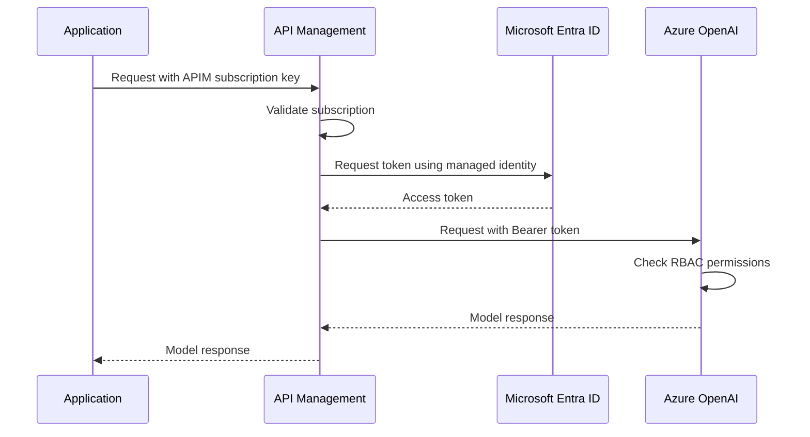
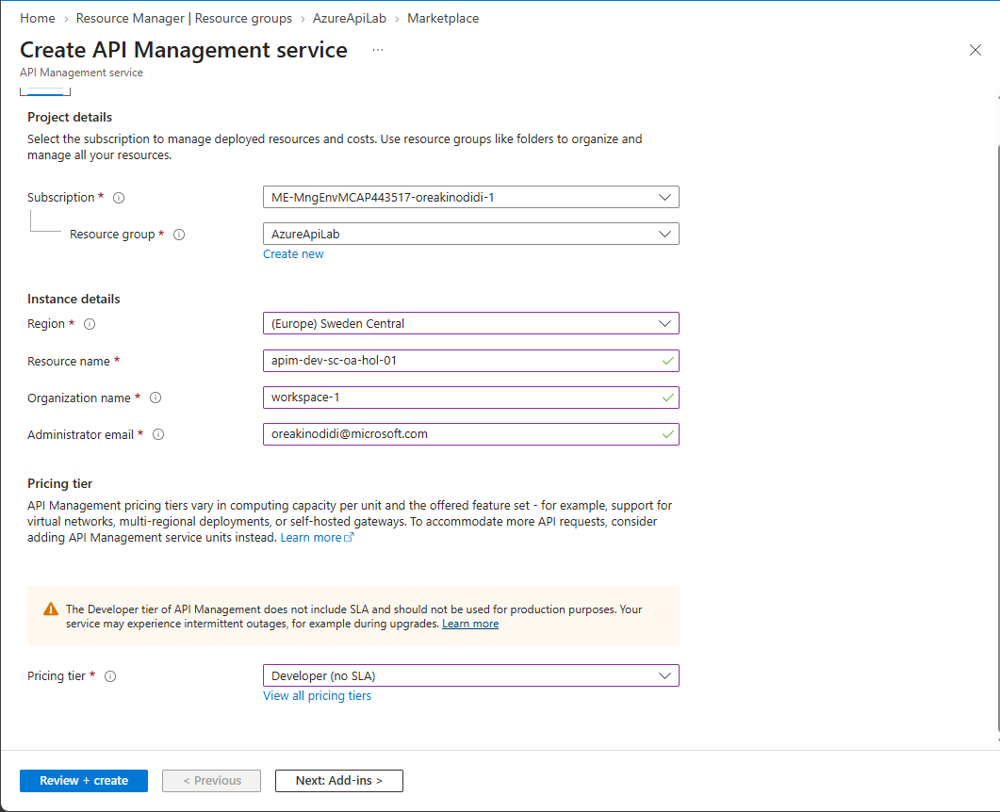

# Authenticate Azure OpenAI requests through Azure API Management

When we build an application that calls an AI model, getting a response is only part of the work. We also need to think about who can access the model, how much traffic it can handle, and how we monitor usage.

This is where Azure API Management (APIM) comes in. Rather than letting every application connect directly to the model endpoint, we can put APIM in front of it and manage those requests in one place.

In this walkthrough, we will deploy an Azure OpenAI model in Microsoft Foundry, expose it through APIM, and configure authentication between the two. The application will use an APIM subscription key, while APIM will use its managed identity to access Azure OpenAI. This means we do not need to give the application an Azure OpenAI API key.

## What does APIM do?

Think of APIM as the front door to your backend APIs. A request reaches APIM first, where policies can check access, apply limits, or change the request before forwarding it to the backend.

These policies are configuration rules, usually written in XML. You can apply them at different scopes, including an individual API or operation. For this lab, we will use an API-level policy to authenticate requests to Azure OpenAI.

APIM can help with more than authentication:

| Capability | What it helps us do |
|---|---|
| Security | Validate Microsoft Entra ID tokens, require subscription keys, and authenticate to backends. |
| Traffic management | Apply rate limits, route requests, and distribute traffic across configured backends. |
| Connectivity | Connect to Azure and on-premises services using the networking options supported by the selected tier. |
| Observability | Collect request logs, metrics, and traces through services such as Azure Monitor and Application Insights. |
| Governance | Manage API versions, access, and publishing consistently across teams. |
| Resiliency | Configure retries, backend circuit breakers, and load balancing where supported. |
| Automation | Define infrastructure and policies in code using tools such as Terraform, Bicep, and CI/CD pipelines. |
| Mock responses | Return example responses so application development can continue before a backend is ready. |

The important point is that these capabilities need to be configured. Putting APIM in front of an API does not automatically enable every protection or monitoring feature.

## Where does the AI gateway fit in?

AI model endpoints are APIs too, but they have some additional constraints. For example, a request limit alone does not tell us how much model capacity an application is using. Ten short requests can consume far fewer tokens than ten requests containing long documents.

APIM's AI gateway capabilities help us manage these AI-specific concerns alongside normal API management:

- **Token usage metrics:** Understand how many tokens applications consume.
- **Token limits:** Control token consumption rather than relying only on request counts.
- **Backend load balancing:** Distribute requests across configured model deployments.
- **Resiliency:** Combine routing, retries, and circuit breakers to handle backend failures or throttling.
- **Semantic caching:** Use an embedding model and a compatible external cache to look for prompts with a similar meaning and reuse a cached response when appropriate.
- **Streaming:** Forward responses incrementally so the application can display output as it arrives.

Semantic caching needs particular care. Similar prompts do not always deserve the same answer, especially when responses depend on a user's identity, private data, or information that changes frequently.

For this lab, we will focus on authentication. Check tier and policy support before extending the example with other AI gateway features.

## Understand the authentication flow

There are two separate connections to configure:

1. **Application to APIM:** The application sends an APIM subscription key. APIM checks that the subscription is active and allowed to access the API.
2. **APIM to Azure OpenAI:** APIM obtains a Microsoft Entra access token using its managed identity. Azure OpenAI checks that identity's Azure role-based access control (RBAC) permissions.



APIM can cache the access token until it expires, so it does not need to request a new token for every model call.

> [!IMPORTANT]
> An APIM subscription key is not an Azure OpenAI API key or a user identity. Treat it as a secret. For production scenarios that require user or application identity validation, consider Microsoft Entra ID authentication at the gateway as well.

## Before you start

You will need:

- An Azure subscription with permission to create APIM and Microsoft Foundry resources.
- Permission to assign Azure roles on the Azure OpenAI resource, or help from someone who has that permission.
- Access to deploy an Azure OpenAI chat model, with sufficient quota in your chosen region.
- Access to the Azure portal.
- `curl` if you want to test from a terminal.

This walkthrough uses an Azure OpenAI deployment in Foundry. Other model providers and endpoint types can have different authentication requirements, roles, and request formats.

## Step 1: Choose resource names

Before deploying anything, I like to define a consistent naming convention. It makes resources easier to identify and saves us from guessing which environment or application they belong to later.

For this lab, I use the application name, environment, region, owner, and instance number.

| Component | Value | Meaning |
|---|---|---|
| Application name | `hol` | Hands-on lab |
| Environment | `dev` | Development |
| Region | `sc` | Sweden Central |
| Instance | `01` | First instance |
| Owner | `oa` | Resource owner |

The naming patterns are:

- Resource group: `rg-<environment>-<region>-<application-name>-<owner>-<instance>`
- API Management: `apim-<environment>-<region>-<application-name>-<owner>-<instance>`

For example, the APIM instance would be `apim-dev-sc-hol-oa-01`.

The APIM service name must be globally unique, so adjust the owner or instance value if the name is already taken. Keep a note of the final name because we will use it in the gateway URL.

## Step 2: Create the APIM instance

1. In the Azure portal, search for **API Management services** and select **Create**.
2. Select your subscription and resource group.
3. Enter the APIM service name and choose a supported region.
4. Complete the required organisation and administrator details.
5. Select the **Developer** tier for this walkthrough.
6. Review the configuration and create the instance.

I am using the Developer tier for a non-production learning environment. It has no production SLA, and it is not necessarily the cheapest option for every workload. Other tiers, including Consumption, have different feature and networking support, so choose based on what you need rather than price alone.



Deployment can take some time. Wait until it completes before moving on.

## Step 3: Check that the gateway works

Before adding the model endpoint, let's confirm that APIM can handle a basic request.

1. Open the APIM instance in the Azure portal.
2. Select **APIs**, then open **Echo API** if it is available in your instance.
3. Open the **Test** tab and select **GET Retrieve resource**.
4. Select **Send**.
5. Confirm that the response status is `200 OK`.

The portal test console can include a subscription key for you. If the API requires a subscription, calling the same URL from a browser or terminal without a key will usually return `401 Unauthorized`.

To test from a Bash terminal, use an active subscription key that has access to the Echo API:

```bash
export APIM_NAME="<apim-instance-name>"
read -rsp "APIM subscription key: " APIM_SUBSCRIPTION_KEY
printf '\n'

curl --include \
  "https://${APIM_NAME}.azure-api.net/echo/resource?param1=sample" \
  --header "Ocp-Apim-Subscription-Key: ${APIM_SUBSCRIPTION_KEY}"
```

If Echo API is not present, skip this check and test the model API once we have imported it.

> [!WARNING]
> Clearing **Subscription required** allows requests without an APIM subscription key unless another policy protects the API. If you temporarily disable it to explore the Echo API, re-enable it immediately after testing. Leave it enabled for the model API in this walkthrough.

## Step 4: Deploy an Azure OpenAI model in Foundry

1. Open Microsoft Foundry and create or select a project.
2. Open the model catalogue and choose an Azure OpenAI chat model available to your subscription.
3. Select a deployment type supported by your region and quota.
4. Enter a deployment name and deploy the model.
5. Open the deployment details and record its Azure OpenAI endpoint and deployment name.
6. Use the deployment playground to confirm that the model responds.

The **deployment name** is the name you assign to the deployed model. It can be different from the model's catalogue name. When an API request asks for a deployment name, use the deployment name from your resource.

For the deployment-based chat completions example later in this walkthrough, also record a supported API version from the deployment's sample code. Use the Azure OpenAI endpoint, not the Foundry project endpoint.

## Step 5: Enable APIM's managed identity

A managed identity gives APIM an identity in Microsoft Entra ID without us creating or storing a client secret.

1. Return to your APIM instance.
2. Under **Security**, open **Managed identities**.
3. Set the **System assigned** identity status to **On**.
4. Save the change.

We are using a system-assigned identity, which belongs to this APIM instance. The authentication policy can use it without specifying a client ID. A user-assigned identity would need to be selected explicitly in the policy.

### Give the identity permission to call Azure OpenAI

Enabling the identity does not give it access to the model. We still need to assign a role.

1. Open the Azure OpenAI or Azure AI services resource that hosts your deployment.
2. Select **Access control (IAM)**, then **Add role assignment**.
3. Select **Cognitive Services OpenAI User**.
4. For the member type, select **Managed identity**.
5. Find and select your APIM instance's system-assigned identity.
6. Review and create the assignment.

Scope the assignment to the resource hosting the deployment rather than the whole subscription. This limits the identity's access to the resource it needs.

Role assignments can take a few minutes to propagate. If an initial request fails with a permission error, check the assignment and allow time for it to take effect before testing again.

## Step 6: Import the model endpoint into APIM

Now we need to give applications an API they can call through the gateway.

1. In APIM, open **APIs** and select **Add API**.
2. Choose the Microsoft Foundry or Azure OpenAI import option available in your portal.
3. Select the resource and endpoint that host your model deployment.
4. Review the API name, backend service URL, and API URL suffix.
5. Create the API and confirm that it includes the chat completions operation you intend to use.
6. In the API's **Settings**, keep **Subscription required** enabled.

Portal labels can change. The important result is an API in APIM that forwards requests to the correct Azure OpenAI endpoint.

If the import wizard offers to configure managed identity authentication, you can use it. Check the resulting policy before continuing so you do not add a second, conflicting authentication configuration.

### Alternative: Import an OpenAPI specification

You can also select **OpenAPI** and import a specification from a URL or local JSON file. The [Azure REST API specifications repository](https://github.com/Azure/azure-rest-api-specs/tree/main/specification/cognitiveservices/data-plane) contains specifications for Azure AI services.

Choose the specification that matches the Azure OpenAI API and version you plan to use. A GitHub directory URL is not an OpenAPI document; provide the raw specification URL or download the relevant file.

After importing, check that the backend service URL points to your Azure OpenAI resource. A specification describes the API contract, but it does not automatically connect APIM to your deployment or grant access.

## Step 7: Configure authentication to the backend

APIM policies have four sections:

| Section | When it runs |
|---|---|
| `inbound` | Before APIM forwards the request to the backend. |
| `backend` | When APIM forwards the request to the backend. |
| `outbound` | Before APIM returns the response to the caller. |
| `on-error` | When an error occurs during request processing. |

Authentication belongs in the **inbound** section because APIM needs the access token before it calls Azure OpenAI.

1. Open the imported API and select **All operations**.
2. In **Inbound processing**, open the policy code editor.
3. Add the following authentication configuration to the existing `inbound` section, unless equivalent authentication is already configured.
4. Preserve any other required policies and save the change.

```xml
<inbound>
    <base />
    <authentication-managed-identity
        resource="https://cognitiveservices.azure.com"
        output-token-variable-name="managed-id-access-token"
        ignore-error="false" />
    <set-header name="Authorization" exists-action="override">
        <value>@("Bearer " + (string)context.Variables["managed-id-access-token"])</value>
    </set-header>
</inbound>
```

The complete policy structure for this example is also available in [`policy.xml`](./policy.xml).

Here is what the configuration does:

1. `<base />` includes policies inherited from the parent scope.
2. `authentication-managed-identity` asks Microsoft Entra ID for a token using APIM's managed identity. The resource value identifies the Azure AI services token audience; it is not your deployment endpoint.
3. `output-token-variable-name` stores the token in `managed-id-access-token`.
4. `set-header` adds that token to the backend request as `Authorization: Bearer <token>`. Using `override` replaces any existing value for this header.
5. `ignore-error="false"` stops processing if token acquisition fails rather than forwarding an unauthenticated request.

The policy obtains and sends a token. The RBAC assignment from the previous step is what authorises that identity to use Azure OpenAI.

## Step 8: Create an APIM subscription

The backend connection is configured. Next, we need a subscription key for the application-to-APIM connection.

1. In APIM, open **Subscriptions** and select **Add subscription**.
2. Enter a name that identifies the application or lab.
3. Set the scope to **API** and select the model API you imported.
4. Create the subscription and confirm that its state is **Active**.
5. Copy its primary key and store it securely.

APIM subscriptions have primary and secondary keys so you can rotate one while applications use the other. Neither key is an Azure OpenAI resource key.

### Check the subscription header name

By default, APIM expects the subscription key in the `Ocp-Apim-Subscription-Key` header.

Some Azure OpenAI client integrations send an `api-key` header instead. To support that pattern, open the API's **Settings** and explicitly set its subscription key header name to `api-key`.

Use the header name configured on your API. Sending an APIM subscription key in `api-key` will not work if APIM still expects `Ocp-Apim-Subscription-Key`. In either case, this is the gateway's key; managed identity still handles authentication to Azure OpenAI.

The terminal example below uses the default `Ocp-Apim-Subscription-Key` header.

## Step 9: Test the model through APIM

### Test in the Azure portal

1. Open the imported API's **Test** tab.
2. Select the **POST** chat completions operation.
3. Select the subscription you created, or supply its key using the configured subscription header.
4. Set any required deployment path parameter and API version.
5. Enter a request body such as:

   ```json
   {
     "messages": [
       {
         "role": "system",
         "content": "You are a helpful assistant. Explain things clearly and simply."
       },
       {
         "role": "user",
         "content": "Explain why we would put API Management in front of an AI model."
       }
     ]
   }
   ```

6. Select **Send**.
7. Confirm that the response status is `200 OK` and that the response contains the model's reply.

For a deployment-based Azure OpenAI route, the deployment name is part of the URL. If your imported operation uses a different contract that requires a `model` field in the body, follow that operation's schema and use the deployment identifier it expects.

### Test from a terminal

Copy the operation's gateway URL from APIM's test console. This avoids guessing the API suffix or duplicating part of the path.

For the deployment-based chat completions route used here, the URL will follow this pattern, with any configured API suffix included:

```text
https://<apim-instance-name>.azure-api.net/<api-suffix>/openai/deployments/<deployment-name>/chat/completions?api-version=<api-version>
```

If your API has no suffix, omit the `<api-suffix>/` segment. Use the actual URL shown in APIM rather than assuming this pattern matches every import.

In a Bash terminal, set that URL and enter the subscription key when prompted:

```bash
export APIM_CHAT_URL="<full-chat-completions-gateway-url>"
read -rsp "APIM subscription key: " APIM_SUBSCRIPTION_KEY
printf '\n'

curl --include \
  --request POST "${APIM_CHAT_URL}" \
  --header "Content-Type: application/json" \
  --header "Ocp-Apim-Subscription-Key: ${APIM_SUBSCRIPTION_KEY}" \
  --data '{
    "messages": [
      {
        "role": "system",
        "content": "You are a helpful assistant. Explain things clearly and simply."
      },
      {
        "role": "user",
        "content": "Explain why we would put API Management in front of an AI model."
      }
    ]
  }'

unset APIM_SUBSCRIPTION_KEY
```

If you configured `api-key` as the subscription header, replace `Ocp-Apim-Subscription-Key` with `api-key` in the command.

Avoid sharing terminal output or traces that contain keys or bearer tokens. If a key is exposed, rotate it.

## Troubleshooting

Start by identifying whether APIM rejected the caller or the backend rejected APIM. The same HTTP status can appear at different points in the flow, so use APIM's test results and authorised tracing tools to locate the failure without exposing credentials.

| Symptom | What to check |
|---|---|
| `401 Unauthorized` from APIM | Confirm that the subscription is active, its scope includes the API, and the key is sent in the configured header. |
| Token acquisition fails | Confirm that APIM's system-assigned identity is enabled and the policy uses the correct token audience. |
| `401` or `403` from the backend | Check the backend endpoint, bearer token policy, and **Cognitive Services OpenAI User** assignment on the resource hosting the deployment. Allow time for RBAC changes to propagate. |
| `404 Not Found` | Check the API suffix, operation path, backend URL, deployment name, and supported API version. |
| `429 Too Many Requests` | Check whether APIM limits or backend model quota caused the rejection. A gateway cannot create additional model capacity. |
| Portal test works, but the application fails | Compare the URL, subscription header, path parameters, API version, and request body. The portal may have supplied values the application is missing. |

## What we have put in place

The application now calls APIM instead of connecting directly to Azure OpenAI. APIM checks the application's subscription key, then uses its own managed identity and RBAC permissions to call the model.

This gives us a central place to manage application access without distributing Azure OpenAI API keys. We can build on the same gateway with token limits, monitoring, and backend routing as we explore the other AI gateway capabilities.

> [!NOTE]
> Putting APIM in front of the model does not block direct access to the backend. Preventing clients from bypassing the gateway requires separate backend access controls and, where appropriate, network restrictions.

When you finish the lab, delete resources you no longer need to avoid ongoing charges. Delete the resource group only if it was created exclusively for this exercise and contains nothing you need to keep.

## References

- [Import a Microsoft Foundry API into Azure API Management](https://learn.microsoft.com/en-us/azure/api-management/azure-ai-foundry-api)
- [Managed identity authentication policy](https://learn.microsoft.com/en-us/azure/api-management/authentication-managed-identity-policy)
- [Subscriptions in Azure API Management](https://learn.microsoft.com/en-us/azure/api-management/api-management-subscriptions)
- [Azure OpenAI role-based access control](https://learn.microsoft.com/en-us/azure/ai-foundry/openai/how-to/role-based-access-control)


## testing 

create a venv and run it 
```powershell
python -m venv agent_env
.\agent_env\Scripts\Activate.ps1
```

Install the project's packages:

```powershell
python -m pip install -r requirements.txt
```

update env values to reflect your model then run main_SKD.py and run main_apim.py 