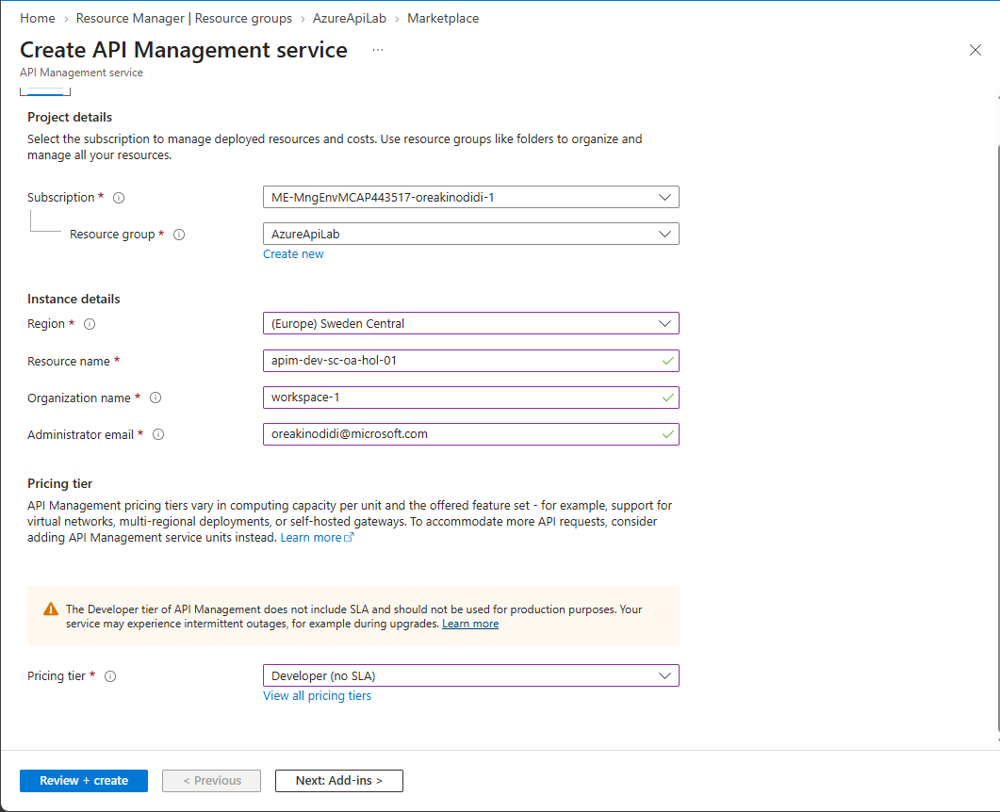

## APIM

 APIM is not just the front door to APIs — it can be the security, governance, observability and traffic-management layer for an enterprise API platform.

Acting as  the governed boundary with policy‑as‑code keeps agent tools secure and scalable.

 Security — Entra ID, OAuth 2.0, JWT validation & policies
 Traffic Management — Rate limiting, throttling & routing
 Hybrid Connectivity — Secure access to Azure and on-prem APIs
 Observability — Azure Monitor, Application Insights & centralized logging
 Governance — API versioning, lifecycle management & access control
 Resiliency — HA, DR and multi-region considerations
 Automation — Terraform/Bicep and CI/CD for consistent deployments

 Why it matters 🔥
✅ Stronger governance: keep APIs consistent, controlled, and enterprise-ready
✅ Better security posture: centralized policies, authentication, and traffic control 🛡️
✅ Faster delivery: streamline how teams publish and manage APIs across workloads
✅ Smoother integration: connect services with clearer boundaries and fewer surprises 🔗

## Create an Azure API Management instance

Before I deploy any Azure resources, I first define a consistent naming
convention. For this lab, I use the application name, environment, region,
instance number, and owner to build each resource name.

| Component        | Value | Meaning              |
|------------------|-------|----------------------|
| Application name | `hol` | Hands-on lab         |
| Environment      | `dev` | Development          |
| Region           | `sc`  | Sweden Central       |
| Instance         | `01`  | First instance       |
| Owner            | `oa`  | Resource owner       |

I use the following naming patterns:

* Resource group: `rg-<environment>-<region>-<application-name>-<owner>-<instance>`
* API Management: `apim-<environment>-<region>-<application-name>-<owner>-<instance>`

The API Management service name must be globally unique. Including the owner
value helps me create a unique name and identify who owns the resource.

I also make a note of the API Management service name because I will use it to
build URLs later in the lab.

For this exercise, I select the **Developer** tier because it provides the
features I need at the lowest cost.



## Verify the Azure API Management instance

The deployment can take some time because Azure creates several supporting
resources in the background. Once the deployment is complete, I verify that my
API Management instance is working:

1. In the Azure portal, I open my new API Management instance.
2. I select **APIs**, and then select **Echo API**.
3. On the **Test** tab, I select the **GET Retrieve resource** operation.
4. I select **Send** to issue a test request.
5. I confirm that the response has a `200 Success` status.

> [!IMPORTANT]
> When I open the request URL in a browser or call it with cURL, I initially
> receive a `401 Unauthorized` response. The Echo API requires a subscription
> key by default. Tests sent from the API Management test console include this
> key automatically, but external requests do not.

For this lab, I temporarily disabled this requirement so I could test the API from
outside the Azure portal. In **Echo API**, I open the **Settings** tab, clear
**Subscription required**, and select **Save**.

Subscriptions are valuable for controlling and monitoring API access. I disable
this setting only to confirm that the API Management instance works as expected
in this lab.

I can now open the request URL in my browser or run the following verbose cURL
command. The request should return a `200 Success` response:

```bash
curl -v "https://<apim-instance-name>.azure-api.net/echo/resource?param1=sample"
```

## Developer portal

The Developer Portal is an automatically generated and customizable website for
my API documentation. API consumers can use it to discover my APIs, learn how
to call them, request access, and test available operations.

API Management uses role-based access control (RBAC) for the Developer Portal.
After creating my API Management instance, I first open the portal as an
administrator to activate it:

1. On the **Overview** page of my API Management instance, I select
   **Developer portal**.
2. Back in the Azure portal, I select **Developer portal** from the resource
   menu, and then select **Portal overview**.
3. I select **Publish** and confirm by selecting **Yes**.

The Developer Portal is now published and available to anonymous and
authenticated users.

### CORS

CORS stands for **Cross-Origin Resource Sharing**. It is a browser security
feature that controls whether a web page can call a resource hosted at a
different origin.

An origin is the combination of a protocol, domain, and port. For example,
`https://portal.example.com` and `https://api.example.com` have different
origins because their domains are different. Even though both sites use HTTPS,
the browser treats a request between them as a cross-origin request.

When the Developer Portal sends a request to my API, the browser checks whether
the API allows requests from the portal's origin. The API communicates this
permission through CORS response headers. If the portal's origin is allowed,
the browser gives the page access to the response. If it is not allowed, the
browser blocks the page from reading the response.

> [!NOTE]
> CORS is enforced by web browsers. Tools such as cURL, Postman, and
> server-to-server applications do not normally enforce it. CORS also does not
> replace authentication or authorization; subscription keys and access tokens
> are still required when an API is configured to use them.

The Developer Portal needs CORS so visitors can test operations from the
interactive API console. I enable it for the default portal domain and add any
custom portal domains that I use. In API Management, CORS is applied through a
policy. I can configure the policy through the policy editor or use the built-in
**Enable CORS** option.

### Users navigating through my portal

I open a private browser window and navigate to the published portal:

```text
https://<apim-service-name>.developer.azure-api.net
```

Using a private window lets me view the portal as an external visitor without
using my Azure administrator session. As an unauthenticated user, I can browse
the available **APIs** and **Products**. The **APIs** page shows the published
operations, their descriptions, and the interactive console.

An external user can create an account, sign in, and request a subscription to
a product. In this lab, the **Unlimited** product requires administrator
approval. When a user submits a request, I receive an email notification and
approve the subscription:

1. In the Azure portal, I open my API Management instance.
2. I select **Subscriptions** and open the new **Unlimited** subscription.
3. I select **Activate subscription**.
4. In the private browser window, I refresh the user's profile page and confirm
   that the subscription is active.

### Test an API from the portal

After activating the subscription, I test one of the published APIs directly
from the Developer Portal:

1. I open **APIs** and select **Echo API**.
2. I review the API description and available operations.
3. I select the `POST` operation and then select **Try it**.
4. I keep the default request values and select **Send**.
5. I confirm that the API returns a `200 OK` response.

### Customize the Developer Portal

The Developer Portal is based on a fork of the Paperbits web framework and
includes features designed specifically for Azure API Management. I can
customize the managed portal through its visual editor or self-host the portal
outside my API Management instance.

Self-hosting is the more advanced option. It gives me access to the portal's
codebase so I can extend its core functionality and control how it is hosted
and maintained.

Under **Deployment + infrastructure**, I can also configure templates for the
email notifications sent to portal users.

### Products

A product groups one or more APIs into a package that I can publish to
developers. It can include usage quotas, access policies, and terms of use.
Once I publish a product, developers can subscribe to it and access its APIs.

I think of a product as an access and subscription boundary rather than a
traditional messaging-based publish-subscribe pattern. The product defines
which APIs are available and which developers can request access to them.

To create and publish a product:

1. In my API Management instance, I open **APIs**, and then select
   **Products**.
2. I add a new product and configure its APIs, subscription settings, and
   usage policies.
3. I open the product and select **Visibility**.
4. I select **Add groups**, and then add the **Developers** and **Guests**
   groups that should be able to see the product.
5. In my private browser session, I open **Products** and confirm that the new
   product tier is visible.

## APIs

An API is a collection of operations that consumers can call. In API
Management, I define the API, add its operations, and associate it with one or
more products. Once the product is published, subscribed developers can use
the APIs included in it.

### Add an API

The **APIs** page shows my existing APIs and gives me options to customise them
or add new ones. For this lab, I manually create an API for the Star Wars API:

1. In my API Management instance, I open **APIs** and select **Add API**.
2. I select **HTTP** to manually define an HTTP API.
3. In the **Create an HTTP API** window, I select **Full**.
4. For **Display name**, I enter `Star Wars`.
5. For **Name**, I enter `star-wars` and optionally add a description.
6. For **Web service URL**, I enter `https://swapi.dev/api`.
7. I keep the URL scheme set to **HTTPS** so that requests use a secure
   connection.
8. For **API URL suffix**, I enter `sw`. This gives the API its own path within
   my API Management gateway URL.
9. I associate the API with the **Starter** and **Unlimited** products.
10. I select **Create**.

> [!NOTE]
> It is good practice to introduce API versioning from the beginning. I omit
> versioning in this lab so I can focus on creating and testing the API.

### Add operations

After creating the API, I open **Star Wars**, select **Add operation**, and add
the following operations:

| Display name       | Name               | Method | URL template   |
|--------------------|--------------------|--------|----------------|
| Get People         | `get-people`       | `GET`  | `/people/`     |
| Get People By ID   | `get-people-by-id` | `GET`  | `/people/{id}/`|

### Test the API in the Developer Portal

After adding the operations, I test the API as a subscribed developer:

1. I open the Developer Portal and sign in with a developer account that has
   an active subscription.
2. I open the **Star Wars** API and select **Get People By ID**.
3. I select **Try it**, enter `2` for the `id` path parameter, and send the
   request.
4. I confirm that the API returns a `200 OK` response with C-3PO's details in
   the response body.

### Import a complete API

Instead of adding each operation manually, I can import a complete API from an
OpenAPI definition. OpenAPI, previously known as Swagger, is a standard format
for describing REST APIs, including their endpoints, operations, parameters,
and responses.

For this lab, I import the [Swagger Petstore](https://petstore.swagger.io/), a
sample API for a pet store service:

1. In my API Management instance, I open **APIs** and select **Add API**.
2. Under **Create from definition**, I select **OpenAPI**.
3. In the **Create from OpenAPI specification** window, I select **Full**.
4. For **OpenAPI specification**, I enter
   `https://petstore.swagger.io/v2/swagger.json`.
5. I confirm that the display name, name, and description are populated from
   the definition, then change both **Display name** and **Name** to
   `Petstore`.
6. I keep the URL scheme set to both HTTP and HTTPS because the backend
   supports HTTPS.
7. For **API URL suffix**, I enter `petstore`.
8. I associate the API with the **Starter** and **Unlimited** products.
9. I select **Create**.

API Management creates the API and imports all the operations defined in the
OpenAPI document. I then test the imported API in the Developer Portal:

1. I open the **Petstore** API and select the **Find pets by status** `GET`
   operation.
2. I select **Try it** and set the `status` parameter to `available`.
3. I send the request and examine the response.

To inspect or modify the imported OpenAPI definition, I return to the API in
the Azure portal and select the edit icon in the **Frontend** section.

### Import the Colors API

I follow the same process to import the
[Colors API](https://colors-api.azurewebsites.net/swagger/v1/swagger.json),
using the following OpenAPI definition:

```text
https://colors-api.azurewebsites.net/swagger/v1/swagger.json
```

For this API, I leave **API URL suffix** empty. This can cause endpoint
conflicts if another API uses the same route. If necessary, I can apply the
`rewrite-uri` policy to transform the incoming request URL into the format
expected by the backend service.

I can also associate products after creating the API. On the **Settings** tab,
I add the **Starter** and **Unlimited** products, and then select **Save**.

### Rate limiting

API Management sits between an API and its callers, so it can control how
frequently clients send requests. Rate limiting protects the backend from
traffic spikes and reduces the impact of abusive or excessive requests.

To demonstrate this, I use the [Colors website](https://colors-web.azurewebsites.net/).
The page displays 500 lights. Each light calls the **Get random color**
operation and applies the returned colour.

#### Allow the frontend with CORS

Before the website can call my API from a browser, I allow its origin in the
CORS policy:

1. In my API Management instance, I open **APIs** and select **All APIs**.
2. In **Inbound processing**, I locate the `cors` policy that I added earlier
   with **Enable CORS**.
3. I select the edit icon next to the policy.
4. I select **Add allowed origin** and enter
   `https://colors-web.azurewebsites.net`.
5. I select **Save**.

> [!NOTE]
> I allow the specific frontend origin rather than `*`. A wildcard allows any
> website to make browser-based requests to the API and is usually too broad
> for a production environment.

#### Configure the Colors website

After enabling CORS, I configure the website to use my API Management gateway:

1. I open the [Colors website](https://colors-web.azurewebsites.net/).
2. I select the menu icon next to **Colors**, and then select **Config**.
3. For the API URL, I enter my gateway endpoint in this format:

   ```text
   https://<apim-instance-name>.azure-api.net/colors/random
   ```

4. I return to **Home** and select **Start**.

The first request returns `401 Unauthorized` because the Colors API requires a
subscription key and I have not supplied one yet.

#### Add subscription keys

I retrieve the primary keys for my **Starter** and **Unlimited** subscriptions
from **Profile** in the Developer Portal. I then prepare one URL for each
subscription, replacing the placeholders with my API Management instance name
and the corresponding key:

```text
https://<apim-instance-name>.azure-api.net/colors/random?key=<starter-primary-key>
https://<apim-instance-name>.azure-api.net/colors/random?key=<unlimited-primary-key>
```

## Policies

API Management policies allow me to control traffic and change API behaviour at
runtime without modifying the backend. I can apply policies at different scopes,
with the more specific scope taking precedence:

```text
Global -> Product -> API -> Operation
```

A request and response pass through the policy pipeline in this order:

```text
Frontend -> Inbound -> Backend -> Outbound -> Frontend
```

I can configure policies during inbound processing, backend processing, outbound
processing, and error handling. I use inbound policies most often because they
can validate or transform a request before it reaches the backend.

### Cross-origin resource sharing (CORS) policy

The `cors` policy allows browser-based applications from approved origins to
call an API. I can apply it to one operation, a complete API, a product, or all
APIs, depending on how broadly I want the rule to apply.

### Caching policy

Response caching allows API Management to temporarily reuse a backend response.
This can reduce latency, bandwidth usage, and load on the backend when the data
does not change frequently.

To test response caching with the Colors API:

1. I open the **Colors API**, and then select the **Get random color** operation.
2. I add a **Cache responses** policy and set the cache duration to `10`
   seconds.
3. In **Inbound processing**, I open the policy **Code view** and confirm that
   the caching policy has been added.
4. I open the [Colors website](https://colors-web.azurewebsites.net/) and call
   the API using my **Unlimited** subscription key.

During each 10-second cache period, API Management returns the same cached
colour. Once the cache expires, the next request retrieves and caches a new
colour.

### Transformation policies

#### Replace a string

The find-and-replace policy searches a request or response body for a string and
replaces it with another value. For example, I can replace `blue` with `red` in
the response from the Colors API:

1. I open the **Colors API**, and then select the **Get random color** operation.
2. In **Outbound processing**, I open the policy code editor.
3. I place the cursor after the `<base />` element in the `<outbound>` section.
4. I select **Show snippets**, and then select **Find and replace string in
   body**.
5. I enter `blue` as the source value and `red` as the replacement value.
6. I save the policy and call the API from the
   [Colors website](https://colors-web.azurewebsites.net/) using my
   **Unlimited** subscription key.

#### Transform a response conditionally

The `choose` policy allows me to apply a transformation only when a condition is
met. In this example, I use the built-in `context` variable to inspect the
response and the caller's product. Callers using the **Starter** product receive
fewer character properties than callers using the **Unlimited** product.

To test the conditional transformation:

1. I open the **Star Wars API**, and then select the **Get People By ID**
   operation.
2. I open the policy code editor and replace the operation's policy with the
   following configuration:

```xml
<policies>
   <inbound>
        <base />
        <set-header name="Accept-Encoding" exists-action="override">
            <value>deflate</value>
        </set-header>
    </inbound>
   <backend>
      <base />
   </backend>
   <outbound>
        <base />
        <choose>
         <when condition="@(context.Response.StatusCode == 200 &amp;&amp; context.Product?.Name != &quot;Unlimited&quot;)">
                <set-body>@{
               var response = context.Response.Body.As&lt;JObject&gt;();

               foreach (var key in new [] {"hair_color", "skin_color", "eye_color", "gender"}) {
                  response.Property(key).Remove();
               }

               return response.ToString();
            }
                </set-body>
            </when>
        </choose>
    </outbound>
   <on-error>
      <base />
   </on-error>
</policies>
```

The inbound policy requests a `deflate` response instead of `gzip`, allowing the
policy to parse and modify the JSON response body.

1. On the **Test** tab, I enter `1` for the `id` parameter.
2. I test the operation with the **Starter** product, and then repeat the test
   with the **Unlimited** product.

The **Unlimited** response includes `hair_color`, `skin_color`, `eye_color`, and
`gender`. The conditional policy removes these four properties from the
**Starter** response.

#### Convert JSON to XML

The `json-to-xml` policy can maintain compatibility with a legacy application
that expects XML while the backend continues to return JSON.

To test this transformation:

1. I open the **Petstore API**, and then select the **Get user by user name**
   operation.
2. In **Outbound processing**, I add the **Convert JSON to XML** transformation
   snippet.
3. I test the operation using `user1` as the username.
4. I confirm that the response body is now XML.

#### Delete a response header

I can remove response headers that expose sensitive backend details or provide
information that callers do not need. To demonstrate this, I first add a custom
header that represents sensitive backend information:

```xml
<json-to-xml apply="always" consider-accept-header="false" />
<set-header name="x-backend-name" exists-action="override">
   <value>petstore-backend</value>
</set-header>
```

I test the operation with the username `user1` and confirm that the
`x-backend-name` header appears in the response. I then update the outbound
policy to delete it before the response reaches the caller:

```xml
<json-to-xml apply="always" consider-accept-header="false" />
<set-header name="x-backend-name" exists-action="override">
   <value>petstore-backend</value>
</set-header>
<set-header name="x-backend-name" exists-action="delete" />
```

When I test the operation again, the `x-backend-name` header is no longer in the
response.

#### Modify a request before sending it to the backend

Inbound transformation policies allow me to add or modify query parameters and
headers before forwarding a request to the backend. To test this, I open the
**Find pets by status** operation in the **Petstore API** and add the following
inbound policies:

```xml
<inbound>
    <base />
    <set-query-parameter name="x-product-name" exists-action="override">
        <value>@(context.Product?.Name ?? "none")</value>
    </set-query-parameter>
    <set-header name="x-request-context-data" exists-action="override">
        <value>@(context.Deployment.Region)</value>
    </set-header>
</inbound>
```

I test the operation with `available` as the status using both the **Starter**
and **Unlimited** products. The policy adds the current product name as the
`x-product-name` query parameter and the API Management region as the
`x-request-context-data` request header before sending the request to the
backend.

### Named Values(Properties)

* Key value pairs global to the service instance
manage string constants across all API config and policies
Values can be expressions, secrets (encrypted by APIM), or Key Vault

To test this out go to the  Named values blade in the resource menu and press + Add.
Create the new property:
Name: TimeNow
Display name: TimeNow
Type: Plain
Value: @(DateTime.Now.ToString())

Then in the API blade
open the Find pets by status operation in the Swagger Petstore API.
change the inbound set-header policy by clicking on the pencil icon.
Create a new header by pressing + Add header:
Name: x-request-received-time
Value: {{TimeNow}}
Action: override

I test the operation with `available` as the status using both the **Starter**
and **Unlimited** products.

### Mock policy

Mock responses allow API consumers to test an operation before its backend is
available. This helps frontend and integration teams continue their work while
the backend is still being developed.

To test a mock response, I add an operation to the **Star Wars API**:

1. I open the **Star Wars API** and select **Add operation**.
2. I create a `GET` operation with the following values:

   | Field        | Value      |
   |--------------|------------|
   | Display name | `Get Film` |
   | Name         | `get-film` |
   | URL template | `/film`    |

3. On the **Responses** tab, I select **Add response**, and then select
   `200 OK`.
4. Under **Representations**, I add the `application/json` content type and
   enter the following sample response:

    ```json
    {
       "count": 1,
       "films": [{ "title": "A New Hope", "release-date": "05/25/1977" }]
    }
    ```

5. I save the operation.
6. In **Inbound processing**, I open **Code view** and add the following policy
   after the `<base />` element:

   ```xml
   <mock-response status-code="200" content-type="application/json" />
   ```

When I invoke the operation, API Management returns `200 OK` with the sample
film data without sending the request to a backend.

### One-way request policy

API Management can call external HTTP services while processing an API request.
The `send-one-way-request` policy sends a fire-and-forget request without
waiting for a response. If I need to wait for and use the response, I use the
`send-request` policy instead.

For this lab, I use an order scenario. When a customer places an order, the API
can return its normal response while API Management sends a separate
notification for downstream processing, such as inventory, fulfilment, or
customer notifications. In production, I would normally use a service such as
Azure Service Bus or Azure Event Grid. For this demonstration, I use
[Webhook.site](https://webhook.site/) so I can inspect the notification.

To test the policy:

1. I create a temporary endpoint on [Webhook.site](https://webhook.site/) and
   copy its unique URL.
2. In the **Petstore API**, I open the **Place an order for a pet** operation.
3. In **Outbound processing**, I open **Code view**.
4. After the `<base />` element, I add the following policy and replace the
   placeholder URL with my Webhook.site URL:

   ```xml
   <send-one-way-request mode="new">
      <set-url>https://webhook.site/&lt;unique-id&gt;</set-url>
      <set-method>POST</set-method>
      <set-header name="Content-Type" exists-action="override">
         <value>application/json</value>
      </set-header>
      <set-body>@{
         return new JObject(
            new JProperty("message", "A pet order was placed"),
            new JProperty("statusCode", context.Response.StatusCode)
         ).ToString();
      }</set-body>
   </send-one-way-request>
   ```

5. I save the policy and invoke the operation.
6. I confirm that the API response completes normally and that Webhook.site
   receives the separate notification.

For more complex asynchronous workflows, retries, or long-running processing,
I would move this logic to a dedicated service such as Azure Logic Apps,
Azure Functions, Service Bus, or Event Grid.

### Abort processing policy

The `return-response` policy allows me to stop policy execution and return a
response immediately. The request does not continue to the backend, which is
useful for validation failures, error handling, or business rules that should
reject a request early.

For this demonstration, I use the deprecated **Finds pets by tags** operation
in the **Petstore API**:

1. I test the operation with a tag such as `photo` and review its normal
   response.
2. I open **Inbound processing**, and then open **Code view**.
3. After the `<base />` element, I add the following policy:

   ```xml
   <choose>
      <when condition="@(true)">
         <return-response>
            <set-status code="500" reason="Internal Server Error" />
            <set-header name="failure" exists-action="override">
               <value>failure</value>
            </set-header>
            <set-body>Internal Server Error</set-body>
         </return-response>
      </when>
   </choose>
   ```

The condition is deliberately set to `true`, so every request follows the
`return-response` path. When I invoke the operation, API Management stops
processing and returns a `500 Internal Server Error` response with the custom
`failure` header.

> [!NOTE]
> I use `500` only to demonstrate how the policy short-circuits a request. For
> a deprecated operation, `410 Gone` would communicate the API status more
> accurately.

After testing, I remove the policy so it does not affect later exercises.

## Versions and revisions

Versions and revisions help me manage an API throughout its lifecycle, but they
solve different problems:

* I use a **version** when I introduce breaking changes. Multiple versions,
  such as `v1` and `v2`, can remain available at the same time so consumers can
  migrate when they are ready.
* I use a **revision** to develop and test non-breaking changes within an
  existing version. I can promote a tested revision or return to an earlier
  one if needed.

API Management can identify a version through the request path, a header, or a
query string. I prefer to introduce a versioning strategy from the beginning,
usually starting with an identifier such as `v1`.

### Create a new API version

To add a path-based version to the **Star Wars API**:

1. I open **APIs**, select the ellipsis next to the **Star Wars API**, and then
   select **Add version**.
2. I configure the version with the following values:

   | Field                 | Value                         |
   |-----------------------|-------------------------------|
   | Version identifier    | `v2`                          |
   | Versioning scheme     | **Path**                      |
   | Full API version name | `star-wars-v2`                |
   | Products              | **Starter** and **Unlimited** |

3. I select **Create**.

The full API version name must be unique within the API Management instance.
Combining the API name and version identifier makes the name clear and avoids
collisions.

API Management adds `v2` to the Star Wars version set and labels the existing
API as **Original**. This organizational change does not alter the existing
API URL, so its consumers are not affected.

To verify the new version, I open the Developer Portal, select `v2` of the
**Star Wars API**, and test an operation. Because I selected path-based
versioning, the request URL now includes `/v2`.

I can introduce breaking changes in `v2` while keeping the original API
available for existing consumers. This gives consumers time to migrate without
interrupting their current integrations.

### Create and test a revision

Next, I use a revision to test a non-breaking caching change before making it
current:

1. I open `v2` of the **Star Wars API** and select the **Revisions** tab.
2. I select **Add revision**, enter `Adding a caching policy` as the
   description, and create the revision.
3. I switch to the **Design** tab and select the **Get People** operation.

The portal now shows revision 2 as the revision I am editing. It is not the
current revision yet, so consumers using the normal API URL continue to use
the current revision. Changes made directly to whichever revision is marked
**Current** take effect immediately.

To add a 10-second response cache to revision 2:

1. In **Inbound processing**, I open **Code view** and add the following policy
   after `<base />`:

   ```xml
   <cache-lookup vary-by-developer="false"
                 vary-by-developer-groups="false"
                 allow-private-response-caching="false"
                 must-revalidate="false"
                 downstream-caching-type="none" />
   ```

2. In **Outbound processing**, I add the following policy after `<base />`:

   ```xml
   <cache-store duration="10" />
   ```

3. I save the policy and test the **Get People** operation from the Azure
   portal.

The test page identifies the revision, and the request URL includes the
revision suffix. It should look similar to:

```text
https://<apim-instance-name>.azure-api.net/sw/v2;rev=2/people/
```

After I confirm that the revised API works as expected, I make it current:

1. I return to the **Revisions** tab.
2. I select the ellipsis next to revision 2 and select **Make current**.
3. I choose to publish the change to the API change log and enter a meaningful
   description of the caching update.

Revision 2 now serves requests made through the normal `v2` URL. The revision
suffix is only needed when I want to address a non-current revision directly.

## Analytics

API Management includes built-in analytics under **Monitoring**. I can use the
**Timeline**, **Geography**, and **APIs** views to understand request volume,
response times, failures, and where API traffic originates.

For deeper monitoring and diagnostics, I can connect API Management to Azure
Application Insights. This gives me a central place to investigate requests,
backend dependencies, exceptions, and performance across my APIs.

### Connect Application Insights

I first create an Application Insights resource using the same naming pattern
as the rest of the lab:

```text
appi-<environment>-<region>-<application-name>-<owner>-<instance>
```

I then connect the resource to API Management by adding it as an Application
Insights logger. After creating the connection, I enable diagnostics for the
**Colors API**:

1. In my API Management instance, I select **APIs**.
2. I open the **Colors API** and select the **Settings** tab.
3. Under **Diagnostic logs**, I open the **Application Insights** settings.
4. I select **Enable**.
5. For **Destination**, I select the Application Insights logger that I added.
6. For this lab, I set **Sampling** to `100%` so every request is captured.
7. I select **Always log errors**, and then save the settings.

> [!IMPORTANT]
> I use `100%` sampling only to make the telemetry easy to observe during this
> lab. For a high-volume production API, I choose a lower sampling percentage
> based on traffic, diagnostic needs, performance, and cost.

### Review the telemetry

Once diagnostics are enabled, Application Insights can receive:

* Request telemetry for incoming gateway requests and responses
* Dependency telemetry for requests that API Management forwards to a backend
* Exception telemetry for failed requests

API Management can classify a request as failed when it:

* Ends because the client connection closes
* Triggers the `on-error` section of an API policy
* Returns an HTTP status code in the `4xx` or `5xx` range

To generate telemetry, I call the **Colors API** through the
[Colors website](https://colors-web.azurewebsites.net/). With sampling set to
`100%`, each request is eligible to be sent to Application Insights. I then
open Application Insights and review the request, dependency, and failure data.

### Balance visibility and performance

Detailed logging adds processing overhead and increases telemetry volume. The
impact depends on the request rate, payload size, sampling percentage, and
whether I log request or response headers and bodies.

Application Insights is designed for monitoring and statistical analysis. I do
not use it as an audit system or assume that every request must be retained for
a high-volume API.

Sampling lets me control how much telemetry is collected. A setting of `100%`
captures all eligible requests, while `0%` disables sampled request telemetry.
A lower percentage can still reveal common connectivity, dependency, and
performance problems because these issues usually affect many requests rather
than a single event.

To reduce overhead while keeping useful operational data, I can:

* Lower the sampling percentage
* Keep **Always log errors** enabled
* Avoid logging request and response bodies unless I need them
* Capture only the headers required for diagnosis
* Review telemetry volume, ingestion cost, and gateway performance regularly

This gives me enough telemetry to investigate recurring issues without
collecting more data than I need.

### Export logs to Event Hubs

Azure Event Hubs is a fully managed service for ingesting real-time data at
scale. I can connect it to API Management to stream gateway logs into a wider
analytics or monitoring pipeline.

#### Create an Event Hubs namespace

I first create a namespace, which provides a unique container for one or more
event hubs:

1. In the Azure portal, I create an **Event Hubs Namespace**.
2. I enter a unique namespace name using this convention:

   ```text
   evhns-<environment>-<region>-<application-name>-<owner>-<instance>
   ```

3. For this lab, I select the **Basic** pricing tier.
4. I review the configuration and create the namespace.

#### Create an event hub

Inside the namespace, I create an event hub to receive the logs from API
Management:

1. I open the namespace and select **Event Hubs**.
2. I select **Create** and enter a name using this convention:

   ```text
   evh-<purpose>-<environment>-<region>-<application-name>-<owner>-<instance>
   ```

3. I choose the partition count and message-retention period, and then create
   the event hub.

Partitions allow multiple consumers to process events in parallel. Message
retention controls how long Event Hubs keeps the data available for consumers.

#### Create access for API Management

API Management needs permission to send events to the event hub:

1. I open the event hub and select **Shared access policies**.
2. I select **Add** and create a policy with **Send** permission.
3. I open the new policy and copy its **Connection string-primary key** to a
   secure location.
4. I also record the event hub name because I need it when I configure the
   logger in API Management.

> [!IMPORTANT]
> The connection string is a secret. I store it securely and avoid adding it
> to source control or sharing it in screenshots.

## Managing AI cost with API Management

### Understand AI tokens

AI models break text into smaller units called tokens. A token can represent a
word, part of a word, punctuation, or a character. The model converts each
token into a numerical identifier so it can process language mathematically
and identify patterns learned during training.

Usage normally includes both input and output tokens:

* Input tokens represent the prompt and other context sent to the model
* Output tokens represent the response generated by the model
* Token counts measure model usage and contribute to the cost of a request

In general, processing more tokens costs more. Pricing can vary by model, and
input and output tokens may be charged at different rates.

### Plan for AI spending

I can use the Azure pricing calculator to estimate the cost of the Azure
resources in my solution. Token-based workloads are harder to predict because
cost depends on user behaviour, prompt size, response length, model choice,
and traffic volume.

The main challenges I need to consider are:

1. **Token economics:** Prompt and completion tokens can have different prices,
   and tokenizers provide only an estimate before a request is processed.
2. **GPU scarcity and price volatility:** Model availability and infrastructure
   costs can change across regions and providers.
3. **Allocation and traceability:** I need to know which users, applications,
   or departments are consuming each model.
4. **Forecasting uncertainty:** Token-based billing varies with usage patterns
   and makes fixed forecasts difficult.
5. **Quality and cost trade-offs:** Larger or more capable models can cost more,
   while a smaller model may be sufficient for some workloads.
6. **Cross-functional spending:** AI adoption across multiple departments can
   distribute spending across many teams and cost centres.

### Use API Management as an AI gateway

An AI gateway sits between clients and AI backends:

```text
Users, agents, and applications -> API Management -> Models, tools, and agents
```

This gives me one place to apply governance, security, safety, scaling,
observability, and cost controls. I can also route requests to Microsoft
Foundry models or supported third-party model endpoints without exposing those
backends directly to clients.

### Limit token consumption

API Management token-limit policies allow me to control how many tokens an
application or user can consume during a defined period. I can use a counter
key, such as a subscription, user ID, application ID, or IP address, to track
usage for each caller.

For example, I can apply a per-minute token limit to this request path:

```text
Application -> API Management token policy -> AI model
```

When a caller exceeds the configured limit, API Management rejects the request
with a `429 Too Many Requests` response. Where supported, the policy can use
the model response to update the counter with the actual token usage rather
than relying only on an estimate made before the request.

> [!NOTE]
> An IP address is useful for a simple demonstration, but it may group several
> users behind the same network address. For production, I prefer a stable
> authenticated identity, application ID, or subscription as the counter key.

### Monitor token usage

I can emit token metrics and send gateway logs to Azure Monitor so I can query,
visualize, and export the data. Depending on the model and policy, the metrics
can include prompt, completion, cached, and reasoning token usage.

My monitoring flow is:

1. I configure the API in API Management to emit the required logs and token
   metrics.
2. I open the connected Log Analytics workspace to query the raw data.
3. I use the results to understand usage by model, application, or caller.
4. I configure Azure Monitor alerts for important thresholds.
5. When a threshold is exceeded, I can notify the owning team or start an
   automated workflow, such as a Logic App.

I can also expose selected usage data through an AI gateway developer portal
so consumers can understand their token consumption. Together, these controls
support a FinOps approach in which I can allocate spending, identify unusual
usage, and balance model quality against cost.

## Security

### JSON Web Tokens (JWT)

JSON Web Tokens are an open standard for representing claims securely between
two parties. I can use a JWT to pass identity and authorization information to
an API in a compact, signed format.

For this lab, I create a short-lived test token:

1. I open [Unix Timestamp](https://www.unixtimestamp.com/) and generate an
   expiration time at least one hour in the future.
2. I open the JWT debugger at [JWT.io](https://jwt.io/).
3. In the encoder, I change the signing algorithm to `HS256`.
4. In the payload, I replace the `exp` claim with the Unix timestamp that I
   generated.
5. I generate the token and use it to test the API before it expires.

The `exp` claim stores the token's expiration time as the number of seconds
since the Unix epoch. API Management should reject the token after that time.

> [!CAUTION]
> I use browser-based JWT tools only with test data and temporary secrets. I
> never paste production tokens, signing keys, or sensitive claims into an
> external website.

### Managed Identities

A managed identity gives an Azure resource its own identity in Microsoft Entra
ID. I can enable one for resources such as Azure Functions, App Service, and
API Management.

After enabling the identity, I assign it only the roles it needs. The resource
can then authenticate to supported Azure services without storing credentials
in application code or configuration.

## DevOps

For a production API Management environment, I use CI/CD rather than making
every change manually in the Azure portal. This makes API definitions and
policies reviewable, repeatable, and easier to promote between environments.

APIOps applies DevOps practices to the API lifecycle. I can store API
Management artifacts in source control, review changes through pull requests,
and deploy them through an automated pipeline. The APIOps hands-on lab provides
a complete walkthrough of this approach.

## Integrate API Management with Azure Service Bus

API Management can send messages directly to an Azure Service Bus queue or
topic by using the `send-service-bus-message` policy. This lets me expose a
governed HTTP API in front of an asynchronous messaging workflow.

The request flow is:

```text
Client -> API Management -> Service Bus queue or topic -> Message consumer
```

This pattern allows API Management to authenticate, validate, transform, and
govern the incoming HTTP request before publishing a message. I do not need to
add an intermediary service whose only purpose is to translate and forward the
request.

### Configure model fallback

I can configure fallback models to improve the reliability of the overall
solution. If the preferred model is unavailable, throttled, or unable to serve
a request, API Management can route traffic to another suitable deployment.

Fallback improves availability, but I still need to consider differences in
model capability, latency, token limits, and price when choosing alternatives.

## Pricing

When I estimate the cost of an AI solution, token pricing is only the starting
point. A production deployment can cost more than an initial estimate once I
include networking, monitoring, support, storage, and model-hosting charges. I
allow contingency in the budget rather than treating the first estimate as the
final value.

The main cost areas I review are:

* **Model usage:** Providers can charge different rates for input and output
   tokens, so I estimate both prompt and completion usage.
* **Data egress:** API traffic, diagnostic logs, and cross-region communication
   can generate outbound data-transfer charges after any free allowance is
   exhausted.
* **Support:** A free support tier may be suitable for learning, but I include
   an appropriate paid support plan for production workloads.
* **Fine-tuned models:** A deployed fine-tuned model can incur hosting or
   provisioned-capacity charges even when it receives little or no traffic.
* **File-search storage:** Stored files, indexes, and vector data may be billed
   by capacity and retention period.
* **Log Analytics:** Diagnostic logs create ingestion and retention costs based
   on the volume of telemetry that I collect.
* **Private connectivity:** Private Link and related networking components can
   add hourly and data-processing charges.

> [!IMPORTANT]
> Prices, free allowances, and billing units vary by service, region, currency,
> and agreement. I verify current figures with the Azure pricing pages and the
> Azure pricing calculator before approving a production budget.

### Understand the full AI cost model

AI spending can feel like a black box when I look only at token rates. I need to
separate the direct model costs from the services that support the wider
solution.

Direct model costs can include:

* Input tokens processed by the model
* Output tokens generated by the model, which normally require more compute
* Provisioned Throughput Units (PTUs), which provide reserved capacity with
   more predictable latency and spending
* Fine-tuning and hosting charges

PTU availability and pricing can vary by deployment type and location, such as
global or regional deployments.

The surrounding platform can also contribute to the total cost. This can
include API Management, Azure AI Search, Azure Managed Redis, Azure Monitor Log
Analytics, and Blob Storage.

### Understand token economics and inference

An agent rarely makes only one model call. It can plan, call a tool, inspect the
result, and repeat the loop before returning an answer. Every turn can consume
more input and output tokens, so the design of the agent is often the real cost
driver.

A token is a unit of text that a model processes and bills against. It can be a
complete word, part of a word, punctuation, or whitespace. Generating output
usually costs more than processing input because generation requires sustained
compute for each new token.

#### Control context growth

Language models are stateless, so a conversational application normally sends
the system prompt and relevant conversation history with each request. As the
conversation grows, the same history is repeatedly counted as input tokens.

To control this context-window growth, I can:

* Keep system prompts concise and avoid repeating instructions already applied
   by the platform or model
* Summarize and deduplicate older conversation turns
* Store state externally, such as in PostgreSQL, and retrieve only the context
   needed for the current request
* Set a maximum completion-token limit and use explicit response constraints
* Use evaluations to find limits that reduce cost without reducing quality

#### Reuse context and route efficiently

Caching can reduce repeated model work. Server-side prompt caching is most
effective when the reusable prompt prefix matches exactly, while semantic
caching can reuse answers for questions with the same meaning.

I can also improve efficiency by:

* Selecting the lowest-cost model that still meets the quality requirement
* Using a model router to balance cost, quality, and request complexity
* Limiting each agent to the tools it needs for the task
* Using Microsoft Foundry tool catalogs to make relevant tools available
   dynamically instead of sending every tool definition on every request
* Running evaluations and using Agent Optimizer to improve the agent against
   the quality targets I define
* Using Microsoft Foundry IQ to organize and ground enterprise knowledge across
   multiple sources

Foundry IQ is a single endpoint that uses a smaller language model to plan the
request, split it into focused queries, search the relevant knowledge sources,
and return grounded context to the agent. Users can also still review the infrastructure
used by this process because retrieval, indexing, and storage create separate
costs.

### Forecast enterprise AI spending

I start with the expected number of conversations per day, estimate the input
and output tokens used by each conversation, and then calculate a monthly
baseline. I compare suitable models to show how model choice changes the
forecast.

This baseline does not represent the complete bill, but it gives me a useful
starting point for capacity planning and optimization.

### Optimize the complete solution

Cloud billing reflects resource consumption across the whole architecture.
Output tokens can be expensive, and inefficient agent loops multiply that
cost. PTUs can make spending more predictable, but regional boundaries,
separately billed search services, and idle fine-tuned deployments can add
costs that are easy to overlook.

I track cost per completed outcome rather than cost per individual model call.
This shows whether the complete workflow delivers enough value for the compute,
retrieval, storage, and monitoring resources it consumes.

Controls I can evaluate include:

* Model routing
* Semantic caching and prompt caching
* Global batch processing for suitable asynchronous workloads
* Context summarization
* Strict agent tool scoping
* PTU reservations when sustained demand supports the commitment
* Content safety services
* Dynamic throttling for `429 Too Many Requests` responses
* Per-tenant API and token limits
* Automated budget alerts or workload suspension

API Management can apply routing, balancing, throttling, and tenant controls.
Evaluation gates can also block changes that reduce quality or increase token
usage beyond an acceptable threshold.

### Monitor five core metrics

I send usage data to an Azure Monitor Log Analytics workspace and monitor:

1. Processed prompt tokens
2. Generated completion tokens
3. PTU utilization
4. Azure AI Search query units
5. Cost per completed outcome

Together, these metrics show both resource consumption and the value produced
by the workload.

### Review spending across three layers

I review AI spending across three layers:

1. Architecture: the models, regions, data stores, and supporting services I
    select
2. Configuration: token limits, capacity, caching, retention, and scaling rules
3. Usage: traffic volume, agent behavior, user patterns, and completed outcomes

Within these layers, I account for five main components:

* Models billed per token or through a commitment tier
* Agents and frameworks that may introduce service or execution charges
* Knowledge tools, such as Foundry IQ, billed through indexing, storage, or
   query volume
* Observability and trust services, such as monitoring and content safety,
   billed by data volume or request
* Local and edge resources used for development, prototyping, or inference

### Build an estimate with the pricing calculator

In the Azure pricing calculator, I can start with a template from the **AI**
category and add the resources used by the architecture. For example, I can add
Foundry tools for the content safety layer and Foundry IQ for retrieval and
indexing.

I then save, share, or export the estimate so I can review the assumptions with
the teams responsible for architecture, operations, and finance.
