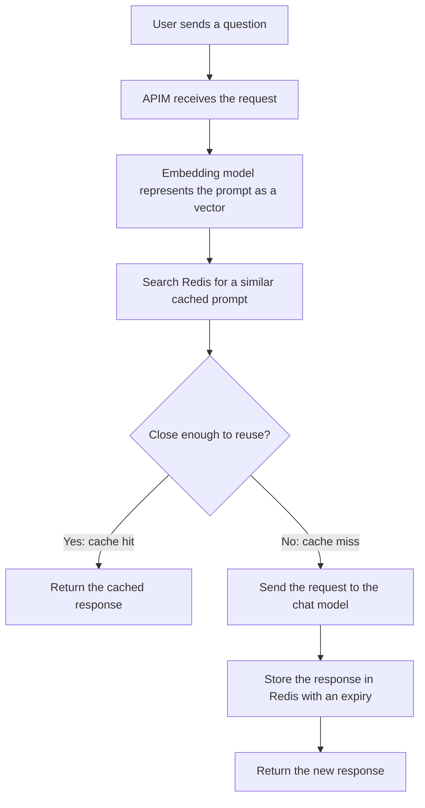
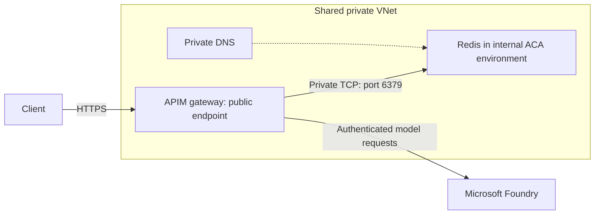

# Semantic caching with Azure API Management

When we build an application that calls an LLM, every request usually goes to the model to generate a response. But users often ask the same question in different ways. If we already have a useful answer, do we need to ask the model again?

This is where **semantic caching** helps. Azure API Management (APIM) can look for a cached answer to a similar question and return it instead of asking the LLM to generate another response.

In this walkthrough, we will connect APIM to a model in Microsoft Foundry, use an embedding model to compare prompts, and store responses in Redis. We have two options for Redis: **Azure Managed Redis** or **Redis hosted in Azure Container Apps (ACA)**.

## Why do we need a cache?

There are three main reasons:

- **Reduce cost:** Reusing an answer avoids another chat completion call to the LLM.
- **Reduce latency:** A cached response can be faster than generating a new answer.
- **Reduce load on the model:** Repeated questions do not all need to reach the chat model.

A cache hit still involves work. APIM needs to compare the incoming prompt with cached prompts, which involves an embedding request and a Redis lookup. We are reducing repeated response generation, not removing every model call or making requests free.

## How is semantic caching different from normal caching?

Normal caching usually looks for an exact match. Semantic caching looks for a match in **meaning**.

For example, a user might ask:

> What is Azure API Management?

Another user might ask:

> Can you explain what APIM does?

The wording is different, but the questions are similar enough that the same answer might be useful. Semantic caching lets us reuse that answer if the match meets the threshold we configure.

The important word here is **might**. Similar questions do not always need the same answer. We still need to test whether caching makes sense for our application.

### What does the embedding model do?

An embedding model converts text into a **vector**, which is a list of numbers representing features of the text's meaning. Redis uses vector search to compare the incoming prompt with prompts that already have cached responses.

We can think of the cache as holding the prompt's searchable representation together with its response. In this demo, system messages are included when assessing similarity because the policy sets `ignore-system-messages="false"`.



### What controls whether an answer is reused?

Two settings are especially important:

| Setting | What it controls | Value in this demo |
| --- | --- | --- |
| `score-threshold` | How closely the incoming prompt must match a cached prompt. Lower values require closer matches. | `0.8` |
| `duration` | How long a cached entry can remain available, in seconds. This is its time to live (TTL). | `60` |

The threshold is **not an "80% confidence" setting**. The current policy reference describes a range from `0.0` to `1.0`, where lower values require higher semantic similarity. Microsoft's guidance is to start with a low value, such as `0.05`, and tune it against real examples. The checked-in `0.8` value is relatively permissive, so test it carefully before using it outside this demo.

With a duration of `60`, an entry expires after 60 seconds. A shorter TTL helps limit stale answers, but also gives us less time to reuse them.

## Before you start

You will need:

- An Azure subscription with permission to create the resources and assign roles.
- An APIM tier and gateway that support the semantic cache policy.
- A chat model deployment and an embedding model deployment in Microsoft Foundry, with enough quota in your chosen region.
- A Redis deployment with vector search support. A plain Redis instance without the required modules is not enough.
- Working authentication and network connectivity between APIM, Foundry, and Redis.
- Terraform if you want to use the configuration included in this folder.

Check the current [semantic caching prerequisites](https://learn.microsoft.com/en-us/azure/api-management/azure-openai-enable-semantic-caching) before deploying. Redis SKU availability, subscription eligibility, model availability, and pricing can affect which option you can use. Container-hosted Redis is an alternative, but it still has infrastructure costs.

> [!NOTE]
> This walkthrough uses the `azure-openai-semantic-cache-lookup` and `azure-openai-semantic-cache-store` policies in the checked-in configuration. Current Microsoft Learn references use the broader `llm-semantic-cache-lookup` and `llm-semantic-cache-store` names. Check the policy support for your gateway and API before adapting this example to another model provider or operation.

## Step 1: Connect APIM to the chat model

Start with a working model request before adding caching. That way, if something fails later, we can separate a cache problem from an authentication or routing problem.

1. Create an APIM instance and a Microsoft Foundry resource.
2. Deploy a chat model in Foundry.
3. Enable APIM's system-assigned managed identity.
4. Give that identity the **Cognitive Services OpenAI User** role on the Foundry resource.
5. Add the Azure OpenAI API to APIM and point it to the Foundry endpoint.
6. Create an APIM subscription for the API and obtain its subscription key.
7. Send a non-streaming chat completion request through APIM and confirm that the model responds successfully.

In this configuration, the client supplies its **APIM subscription key** through `api-key`. APIM then uses its managed identity to authenticate to Foundry. These are two separate authentication steps; the APIM subscription key is not a Foundry API key.

The [root Terraform configuration](IAC/main.tf) connects the modules, and the [APIM module](IAC/modules/APIM/main.tf) creates the API, subscription, managed identity, and role assignment. For more background, see the [APIM authentication walkthrough](../OpenAI_Aunthentication/notes.md).

## Step 2: Configure the embedding model backend

We need a second model for comparing prompts. The chat model generates answers; the embedding model helps APIM decide whether it can reuse an existing answer.

1. Deploy an embedding model in Foundry.
2. In APIM, create a backend named `apim-backend-openai-embedding`.
3. Set its custom URL to the embedding deployment's endpoint, using this shape:

   ```text
   https://<foundry-subdomain>.openai.azure.com/openai/deployments/<embedding-deployment>/embeddings
   ```

4. Make sure APIM's managed identity can access the deployment. The policy uses `embeddings-backend-auth="system-assigned"` for this call.

The Terraform configuration deploys `text-embedding-3-small`, version `1`, with the `Standard` SKU and capacity `10`. It passes the endpoint to APIM automatically. Use the `foundry_embedding_*` variables to override the model, deployment name, SKU, or capacity, and confirm availability and quota in your region.

## Step 3: Choose your Redis backend

The Terraform input `cache_backend` decides which Redis option is created. The default is `managed_redis`; setting it to `aca` selects container-hosted Redis. Only the selected backend is created, and the root `redis_*` outputs describe that backend.

### Option A: Azure Managed Redis

The [Redis module](IAC/modules/Redis/main.tf) creates Azure Managed Redis with RediSearch for vector search. This is the default path.

| Setting | Default or behavior |
| --- | --- |
| Resource name | `redis-<prefix>`, unless you override `redis_name` |
| SKU | `Balanced_B0`, configurable through `redis_sku_name` |
| Transport | TLS |
| Cluster policy | `EnterpriseCluster` |
| Eviction policy | `NoEviction` |
| Authentication | Access key |
| Network access | Public, matching this demo's public APIM setup |

The module receives the shared resource group, location, and tags from the root configuration. Names based on `prefix` are resolved through Terraform locals because variable defaults cannot reference other variables. Explicit name overrides are preserved.

This configuration uses access-key authentication for APIM's external cache connection rather than Microsoft Entra authentication. Check current APIM support before changing the authentication approach.

> [!IMPORTANT]
> Public access is a demo choice. For production, use private connectivity and an APIM gateway that can reach the Redis private endpoint. The connection string is marked sensitive in Terraform outputs, but credentials still exist in Terraform state. Restrict access to the state backend and never commit state files or connection strings.

### Option B: Redis in Azure Container Apps

The [ACA module](IAC/modules/ACA/main.tf) runs Redis in a container. To select it, add this to your Terraform inputs:

```hcl
cache_backend = "aca"
```

This path creates a shared virtual network (VNet), separate subnets for APIM and ACA, an internal Container Apps environment, Log Analytics, and a private DNS zone linked to the VNet.

APIM uses **external-mode VNet injection**. This means its HTTPS gateway remains public, but it can reach Redis through the private network.



This networking configuration requires a classic `Developer_*` or `Premium_*` APIM SKU. It does not support v2 or Consumption SKUs.

The container app sets `external_enabled = true` so APIM can connect from outside the ACA environment. Here, **external means outside the environment, not exposed to the internet**: the environment itself uses an internal load balancer. Environment-only app ingress would prevent APIM from connecting.

The Redis container has the following settings:

- **Image:** `redis:8.2.3`, configurable through `aca_redis_image`. It replaces the retired Redis Stack image, and the startup command explicitly loads the bundled RedisJSON and RediSearch modules.
- **Authentication:** A random 32-character password supplied through an ACA secret. The password also exists in Terraform state.
- **Connection:** Password-authenticated TCP on port `6379`, without TLS, inside the private VNet only.
- **Replicas:** One replica stays running. Independent Redis replicas would have separate data and produce inconsistent cache results.
- **Memory:** Redis is configured with a `768mb` memory limit and `noeviction`. When that limit is reached, Redis does not automatically discard existing entries to make room.
- **Persistence:** This is an ephemeral cache. Restarts can lose its contents; it is not durable storage.

The default network ranges are:

| Network | Address range |
| --- | --- |
| Shared VNet | `10.0.0.0/16` |
| ACA subnet | `10.0.0.0/23` |
| APIM subnet | `10.0.2.0/24` |

Override the `aca_*_prefix` inputs if these ranges overlap with your existing networks.

> [!WARNING]
> Non-TLS Redis is a demo trade-off, not a production recommendation. Keep this configuration private. For production, add Redis TLS and certificate trust.

> [!WARNING]
> Changing `cache_backend` after deployment can delete the old cache and its data, and also changes APIM networking. Review the Terraform plan and allow for a maintenance window, especially with Developer APIM.

## Step 4: Register Redis as APIM's external cache

Once Redis is available, APIM needs its connection details.

1. Obtain the selected Redis backend's connection string.
2. Open your APIM instance and find its external cache settings.
3. Add the Redis connection string and configure the cache as the default external cache.
4. Confirm that APIM can reach the endpoint over the required network path.

The Terraform configuration handles this registration through the [APIM module](IAC/modules/APIM/main.tf). It uses `cache_location = "default"` and supplies the connection string from the selected Redis module.

Do not paste the connection string into notes, screenshots, or source-controlled files. Treat it as a credential.

## Step 5: Apply the semantic cache policy

We use two policies:

- **Lookup in `inbound`:** Search for a cached response before calling the chat model.
- **Store in `outbound`:** Cache the response after the chat model answers.

The [checked-in policy](policy/policy.xml) also handles managed identity authentication:

```xml
<policies>
    <inbound>
        <base />
        <authentication-managed-identity
            resource="https://cognitiveservices.azure.com"
            output-token-variable-name="managed-id-access-token"
            ignore-error="false" />
        <set-header name="Authorization" exists-action="override">
            <value>@("Bearer " + (string)context.Variables["managed-id-access-token"])</value>
        </set-header>
        <azure-openai-semantic-cache-lookup
            score-threshold="0.8"
            embeddings-backend-id="apim-backend-openai-embedding"
            embeddings-backend-auth="system-assigned"
            ignore-system-messages="false">
        </azure-openai-semantic-cache-lookup>
    </inbound>
    <backend>
        <base />
    </backend>
    <outbound>
        <azure-openai-semantic-cache-store duration="60" />
        <base />
    </outbound>
    <on-error>
        <base />
    </on-error>
</policies>
```

Keep any existing policies that your API needs for authentication, routing, and other controls when applying this example.

Terraform loads this policy after creating the embedding backend, Redis cache registration, and OpenAI role assignment. Role assignments can take time to propagate, so resource creation alone does not prove that authentication is ready.

## Step 6: Check that caching actually works

For the first test, keep the deployment, system message, and other request settings the same. Only change the user's question when testing a similar prompt.

1. Send a question that is not already cached, such as "What is Azure API Management?" Confirm that the chat model responds.
2. Send the exact same request again within 60 seconds. Use APIM tracing and backend request telemetry to check whether APIM returned a cached response without another chat completion call.
3. Within the same TTL window, try "Can you explain what APIM does?" Check both whether it hits the cache and whether the returned answer is appropriate.
4. Try a clearly unrelated question. Confirm that it does not reuse the APIM explanation. If it does, lower the threshold and repeat the test with fresh entries.
5. Let the original entry expire, then send the original question again. Confirm that the request reaches the chat model.

A faster response or identical text alone does not prove a cache hit. Look for evidence that the chat completion backend was skipped. Embedding calls may still appear during a cache hit.

If the test fails, check the embedding backend URL, managed identity permissions, Redis credentials, required Redis modules, network connectivity, and private DNS where applicable.

### When should we avoid reusing a response?

Be careful with answers that depend on user identity, private data, live information, or details that change the meaning of the request. Including system messages in the similarity check is not a security boundary.

The demo policy does not configure a `vary-by` partition. Do not assume it isolates cached answers by user or tenant. For a multi-user application, use appropriate cache partitioning based on validated identity and test that users cannot receive each other's private responses.

Also keep backend rate limits in place. If the cache becomes unavailable, more requests may reach the chat model. Caching is an optimization, not a replacement for authentication, authorization, or overload protection.

## Validate the Terraform configuration without deploying

The Redis module requires AzureRM `>= 4.67.0, < 5.0.0`. Mocked Terraform tests require Terraform 1.7 or later and do not create Azure resources.

Start each command block below from the repository root.

### Validate the full configuration

```powershell
Set-Location .\APIM\SemanticCaching\IAC
terraform init -backend=false
terraform validate
terraform test
```

The root tests check the Redis-to-APIM connection configuration, including default and overridden resource names.

### Validate Managed Redis on its own

```powershell
Set-Location .\APIM\SemanticCaching\IAC\modules\Redis
terraform init -backend=false
terraform validate
terraform test
```

### Validate the Container Apps alternative

```powershell
Set-Location .\APIM\SemanticCaching\IAC\modules\ACA
terraform init -backend=false
terraform validate
terraform test
.\tests\redis-smoke.ps1 -Image redis:8.2.3
```

The smoke test requires Docker with Linux containers. It runs the configured Redis startup command in an isolated container with no published ports, checks that unauthenticated access is rejected, and verifies that a nearest-neighbor vector query returns the expected document at zero cosine distance. It removes the container afterward.

The [validation workflow](../../.github/workflows/semantic-cache-terraform.yml) runs Terraform formatting, validation, and mocked tests on relevant pull requests, matching pushes to `main`, and nightly. It also runs the Docker smoke test on Linux.

These checks validate configuration wiring and local Redis behavior. They do **not** prove live Azure authentication, networking, model quota, or APIM cache hits. Use Step 6 after deployment to check the actual request flow.

### Before an actual deployment

Authenticate to Azure and initialize the configured state backend **without** `-backend=false`. Confirm that its state key is dedicated to this stack; the checked-in configuration currently uses `apim.tfstate`.

Review `terraform plan` before applying, including resource costs, network changes, and anything Terraform plans to replace or delete.

## Further reading

- [Enable semantic caching in APIM](https://learn.microsoft.com/en-us/azure/api-management/azure-openai-enable-semantic-caching)
- [Semantic cache lookup policy reference](https://learn.microsoft.com/en-us/azure/api-management/llm-semantic-cache-lookup-policy)
- [Semantic cache store policy reference](https://learn.microsoft.com/en-us/azure/api-management/llm-semantic-cache-store-policy)