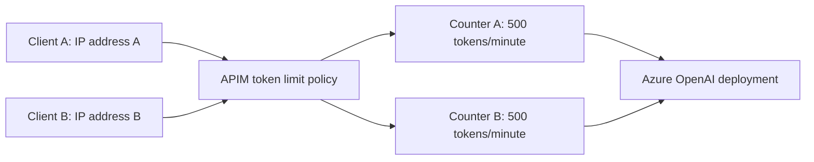
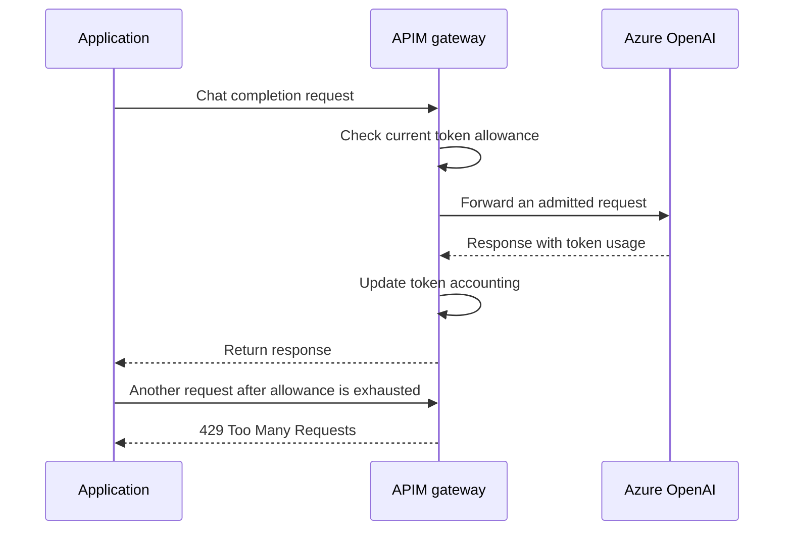

# Control Azure OpenAI token usage with Azure API Management

When we build an application that calls an LLM, limiting the number of requests is not always enough. One user might send a short question, while another sends several pages of text. Both count as one request, but they can consume very different amounts of model capacity.

This is where a token limit policy helps. Azure API Management (APIM) can track token usage and limit how much an application or group of users consumes through the gateway.

In this walkthrough, we will apply a limit of **500 tokens per minute**, group requests by client IP address, and return the remaining allowance in a response header. We will also look at why this is a usage control rather than a guaranteed hard cap on every request.

## What are we limiting?

Models process text as **tokens**. A token can be a word, part of a word, punctuation, or another unit determined by the model's tokenizer.

A typical chat completion consumes:

- **Prompt tokens:** The input sent to the model, including messages and other context.
- **Completion tokens:** The output generated by the model.

The Azure OpenAI token limit policy manages token consumption rather than simply counting HTTP requests. This makes it useful when requests vary significantly in size.

The limit we configure in APIM is separate from the model deployment's own quota. A request can be within the gateway's allowance and still receive a throttling response from Azure OpenAI if the deployment has reached its capacity.

## How does APIM decide whose tokens to count?

The policy uses a **counter key** to group requests. Requests with the same key share the same token allowance.

For this lab, the key will be:

```xml
counter-key="@(context.Request.IpAddress)"
```

This means APIM groups requests by the client IP address it sees. If two requests have the same IP address, they contribute to the same counter.



> [!IMPORTANT]
> An IP address is not a user identity. Users behind the same office network, proxy, or other shared connection may share one counter. For application-level limits, consider an APIM subscription identifier. For user-level limits, use an identifier derived from a validated identity, not a caller-controlled header that users can change to bypass the limit.

## Before you start

You will need:

- An APIM instance on a tier that supports `azure-openai-token-limit`. The Consumption tier does not support this policy; check the current policy reference for your tier and gateway.
- An Azure OpenAI model deployment in Microsoft Foundry.
- An API in APIM that forwards chat completion requests to that deployment.
- Working authentication between the application, APIM, and Azure OpenAI.
- Permission to edit the API's policies.

If you have not configured the gateway yet, follow the [APIM authentication walkthrough](../OpenAI_Aunthentication/notes.md) first.

This example focuses on non-streaming Azure OpenAI chat completion requests. Check the policy's supported operations and streaming behavior before applying the same assumptions to another API.

## Step 1: Confirm that the model API works

Before adding a limit, send a request through APIM and confirm that the model responds.

1. Open your APIM instance in the Azure portal.
2. Select **APIs** and open the Azure OpenAI API.
3. Open the **Test** tab and select the chat completions operation.
4. Supply the required subscription key, deployment name, API version, and request body.
5. Select **Send** and confirm that the response is successful.

Starting with a working request helps us separate authentication or routing problems from token-limit behavior.

## Step 2: Add the token limit policy

Open the policy editor for the API, such as at the **All operations** scope. Add the following policy inside the existing `inbound` section and preserve the authentication and routing policies you already need:

```xml
<azure-openai-token-limit
    counter-key="@(context.Request.IpAddress)"
    tokens-per-minute="500"
    estimate-prompt-tokens="false"
    remaining-tokens-variable-name="remainingTokens" />
```

Here is what each setting does:

| Setting | Meaning |
|---|---|
| `counter-key` | Groups requests by the IP address APIM sees. |
| `tokens-per-minute="500"` | Sets a per-minute token allowance for each counter key. |
| `estimate-prompt-tokens="false"` | Disables estimating the prompt's token usage before forwarding the request. |
| `remaining-tokens-variable-name="remainingTokens"` | Makes remaining-token information available as a policy context variable. |

The variable name does not automatically create a response header. We will configure that separately in the next step.

### Why can a request exceed the allowance?

With prompt estimation disabled, APIM does not predict the incoming prompt's size before forwarding it. It uses token usage reported by the backend response to update its accounting.

For example, suppose a counter has 100 tokens remaining. A request is admitted and then consumes 150 tokens in total. Those tokens have already been consumed by the time the backend returns its usage information.

The policy can then enforce the limit on later requests, but it cannot undo the completed model call.



This flow explains why `500 tokens per minute` should not be treated as a guarantee that measured consumption can never exceed 500. In-flight requests and distributed gateway accounting can also affect enforcement.

Setting `estimate-prompt-tokens="true"` allows prompt estimation before forwarding and can help reject requests whose estimated input would exceed the allowance. It still cannot know the exact size of the generated response in advance, so it is not a strict cost cap.

## Step 3: Return the remaining allowance in a header

To make the remaining allowance visible to the application, use the policy's `remaining-tokens-header-name` setting.

Update the policy to:

```xml
<azure-openai-token-limit
    counter-key="@(context.Request.IpAddress)"
    tokens-per-minute="500"
    estimate-prompt-tokens="false"
    remaining-tokens-variable-name="remainingTokens"
    remaining-tokens-header-name="x-remaining-tokens" />
```

We now have two ways to use the information:

- **Inside APIM:** Other applicable policy logic can use the `remainingTokens` context variable.
- **In the application:** The caller can inspect the `x-remaining-tokens` response header when the policy provides it.

Remaining tokens describe the gateway's allowance, not the deployment's available capacity or the exact usage of the individual request. For a successful non-streaming chat completion, inspect the response body's `usage` fields to see the backend-reported prompt and completion tokens.

If a browser application needs to read the custom header across origins, its CORS configuration must expose `x-remaining-tokens`. Do not assume a header visible in developer tools is automatically accessible to JavaScript.

## Step 4: Test the limit

Use a small, controlled test workload. Model requests consume quota and can incur charges, even while testing the policy.

1. Send a successful chat completion request through APIM.
2. Inspect the response body's token usage and the `x-remaining-tokens` header.
3. Send more requests from the same client IP address.
4. Check how the allowance changes as usage is accounted for.
5. Continue until APIM rejects a request with `429 Too Many Requests`.
6. Allow the rate-limit window to recover, then confirm that requests can succeed again.

Do not assume a calendar-minute reset or an exact countdown from a single header. Use the policy's observed behavior and any retry guidance returned by the gateway.

| Scenario | What to verify |
|---|---|
| A small request within the allowance | The model responds, and remaining-token information is returned where applicable. |
| Repeated requests from the same IP | Requests contribute to the same counter. |
| Requests from genuinely different client IPs | They use separate counters, subject to any other policies. |
| A request that consumes more than the remaining allowance | With estimation disabled, the completed call can take usage beyond the configured limit. |
| A request after the allowance is exhausted | APIM returns `429` without forwarding that rejected request to the model. |
| Requests after the limit window recovers | The gateway admits requests again. |
| Backend throttling | The backend can independently return `429`, even when the APIM allowance is not exhausted. |

Use authorised APIM traces to distinguish a gateway rejection from a backend rejection. The status code alone does not tell us which limit was reached.

## Practical considerations

### Choose the counter key for the behavior you need

IP-based grouping is convenient for a lab, but it can unfairly group unrelated users or let the same user obtain a different counter by changing networks.

For a real application, decide whether the allowance belongs to an application, tenant, or authenticated user. Then choose a trusted counter key that represents that boundary.

### Coordinate policy scopes

Policies can be inherited from broader scopes. Check existing token limits and counter-key expressions before adding another one, particularly when several APIs should have separate budgets.

A backend pool does not automatically give each backend a separate caller allowance. The token policy applies to requests at its configured gateway scope; backend selection is a separate concern.

### Keep token limits and monitoring separate

The policy helps control usage. It does not replace monitoring, usage reporting, or billing alerts.

If you need to understand consumption across applications, combine limits with appropriate logs and token metrics. The [logs and metrics notes](../Logs_Metrics/notes.md) cover that topic separately.

## What we have put in place

APIM now groups requests by client IP address and applies a 500-token-per-minute allowance. It can also return remaining-token information so the application can respond more clearly when usage is running low.

The key detail is that disabling prompt estimation makes accounting depend on completed backend responses. This is useful for tracking reported usage, but it can allow an admitted request to exceed the remaining allowance. Choose the counter key and estimation setting based on the behavior your application needs.

## References

- [Azure OpenAI token limit policy](https://learn.microsoft.com/en-us/azure/api-management/azure-openai-token-limit-policy)
- [APIM policy scopes and inheritance](https://learn.microsoft.com/en-us/azure/api-management/api-management-howto-policies)
- [APIM authentication walkthrough](../OpenAI_Aunthentication/notes.md)
