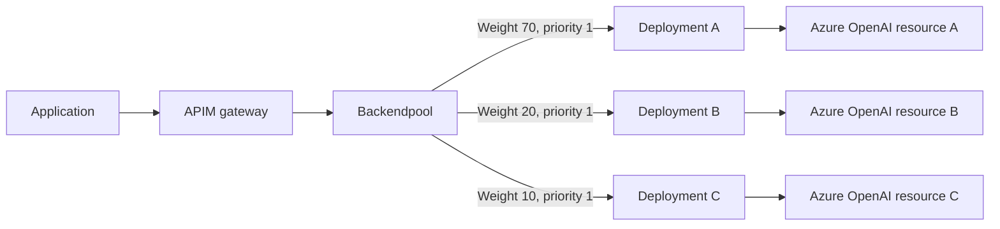
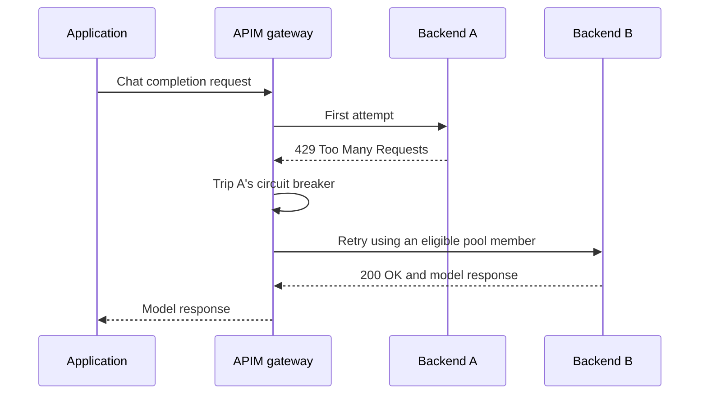

# Load balance Azure OpenAI requests with Azure API Management

When we build an application that calls an LLM, we want it to stay available even when a model deployment reaches its limits. A single deployment can become a bottleneck as more users send requests or prompts get longer.

This is where Azure API Management (APIM) can help. Instead of sending every request to one deployment, we can put several deployments behind a backend pool and let APIM distribute the traffic.

In this walkthrough, we will connect three Azure OpenAI deployments to APIM, configure a weighted backend pool, and add circuit breakers and retries. The application will still call one gateway endpoint; APIM will handle the backend selection.

## Why load balance model requests?

LLM capacity is not just about the number of requests. Deployments can have both token-per-minute (TPM) and request-per-minute (RPM) limits. Long prompts and the output capacity requested can affect throttling, so a small number of requests can still consume a significant amount of capacity.

When a deployment reaches a limit, it can return `429 Too Many Requests`. We need a way to manage that pressure without making the application depend entirely on one deployment.

There are several options:

| Option | What it helps with |
|---|---|
| Request more quota or increase deployment capacity | Give a deployment more capacity where quota and availability allow it. |
| Use provisioned throughput | Allocate provisioned capacity for suitable workloads rather than relying only on pay-as-you-go capacity. |
| Choose a Global or Data Zone deployment type | Use the service's routing options within the deployment type's supported geographic boundaries. |
| Use multiple deployments | Give APIM several backends to distribute requests across. |

Provisioned throughput units (PTUs) are a separate capacity and billing option, not simply an increase to pay-as-you-go limits. Global and Data Zone deployments also have different data-processing boundaries, so check your requirements before choosing one.

For this lab, we will focus on multiple deployments. Load balancing does not create additional quota by itself; the pool is useful only if its members have capacity available.

## How the backend pool works

A **backend** in APIM describes a service that APIM can call. A **backend pool** groups several of those backends so the gateway can select one for each request.

We will use three Foundry resources, each hosting an Azure OpenAI deployment with the same deployment name and compatible configuration.



The pool's membership, weights, and priorities are configured on APIM backend resources. Circuit breaker rules are configured on the individual backends. The API policy selects the pool; it does not define those settings.

### Weights: How much traffic should each backend receive?

Weights express a relative share of traffic among eligible backends at the same priority.

For this example, we will use weights of `70`, `20`, and `10`. When all three backends are available, we expect roughly 70%, 20%, and 10% of requests to go to each one over a sufficiently large sample.

This is not a promise that every ten requests will split exactly seven, two, and one. Backend selection is approximate, and retries or unavailable backends can change the observed distribution. It also distributes requests, not an exact percentage of token usage.

### Priorities: Which backends should APIM use first?

Priority determines which group of backends APIM prefers. Lower numeric values have higher priority.

In this lab, all three backends have priority `1`, so they participate in the same preferred group. If we wanted a primary group and a fallback group, we could assign the primary backends a lower priority value and the fallback backends a higher one.

Weights and priorities serve different purposes: weights share traffic within a group, while priorities express which group to prefer.

### Circuit breakers: When should APIM stop using a backend?

A circuit breaker temporarily removes a backend from selection after the configured failure condition is met. This avoids repeatedly sending requests to a deployment that is already throttling.

For this lab, the breaker will react to `429` responses. Once it trips, APIM can select another eligible pool member for subsequent attempts.

Circuit breaker state and load-balancing decisions are not a globally synchronised counter across all gateway instances. Treat them as resilience controls, not a guarantee of perfectly coordinated traffic distribution.

### What about blue-green deployments?

A backend pool can also help us gradually shift traffic during an upgrade. We can add a new, compatible deployment, send a small share of traffic to it, and increase its weight after checking the results.

This works only if the deployments can serve the same request contract. A different model version can change output quality or behavior even when the API format remains the same, so test the application before moving all traffic.

## Before you start

You will need:

- An APIM instance on a tier that supports backend pools and backend circuit breakers.
- Three Foundry resources hosting Azure OpenAI deployments with capacity available.
- The same deployment name, model version, and compatible deployment configuration across the three backends.
- Permission to assign Azure roles on each resource.
- An APIM API exposing the chat completions operation.
- An active APIM subscription key if the API requires a subscription.

Check that the chosen regions and deployment types meet your data-processing requirements. Cross-region routing can also affect latency.

If managed identity authentication is new to you, start with the [APIM authentication walkthrough](../OpenAI_Aunthentication/notes.md). We will use the same authentication flow here, but grant APIM access to all three backend resources.

## Step 1: Create the model deployments

1. Create or select your APIM instance.
2. Create three Foundry resources in supported regions.
3. Deploy the same Azure OpenAI model in each resource.
4. Give each deployment the same name, such as `chat-model`.
5. Confirm that the model version and request parameters are compatible.
6. Test each deployment directly using an authorised account.
7. Record each resource's Azure OpenAI endpoint.

Using the same deployment name matters because APIM will forward the same operation path to whichever backend it selects. A request for `chat-model` will fail if that deployment does not exist on the selected resource.

## Step 2: Give APIM access to all three resources

1. Enable the APIM instance's **system-assigned managed identity**.
2. Open the first resource hosting an Azure OpenAI deployment.
3. Under **Access control (IAM)**, assign **Cognitive Services OpenAI User** to APIM's managed identity.
4. Repeat the assignment on the other two resources.
5. Allow time for the role assignments to propagate.

Scope each assignment to the resource APIM needs to call. The same managed identity will authenticate to every pool member, so it needs permission on all three.

The application-to-APIM connection is separate. An APIM subscription key allows the application to call the gateway; it does not grant APIM permission to call Azure OpenAI.

## Step 3: Create the individual APIM backends

1. In APIM, open **Backends**.
2. Create a backend for each Azure OpenAI resource.
3. Give them clear identifiers, such as `openai-backend-a`, `openai-backend-b`, and `openai-backend-c`.
4. Set each backend's URL to the corresponding Azure OpenAI resource endpoint.
5. Check that the backend base URL and API operation path combine into the correct model URL.

For a deployment-based chat completions API, the forwarded path includes `/openai/deployments/<deployment-name>/chat/completions`. Avoid including that path twice by adding it to both the backend base URL and the API operation.

## Step 4: Add a circuit breaker to each backend

Open each individual backend and configure the following rule:

| Setting | Value | Why we use it |
|---|---|---|
| Rule name | `openAIBreakerRule` | Identifies the rule. |
| Failure count | `1` | One matching failure is enough to trip the breaker. |
| Failure interval | `5 minutes` | The time window used to evaluate failures. |
| Status code range | `429` to `429` | Reacts specifically to throttling responses. |
| Trip duration | `1 minute` | The configured period to stop selecting the backend. |
| Accept `Retry-After` | `true` | Allows the backend's retry guidance to influence the trip duration. |

Repeat this configuration for all three backends.

The five-minute failure interval is not the time the circuit stays open. The trip duration controls that period, and accepting `Retry-After` can cause it to differ from the configured one minute.

> [!NOTE]
> This rule handles throttling only. It does not trip on `500`, `503`, or connection failures. Handling those conditions requires a separately considered breaker configuration; retrying them is not the same as marking a backend unavailable.

## Step 5: Create the backend pool

1. In **Backends**, create a backend pool named `Backendpool`.
2. Add the three backends you created.
3. Set all three priorities to `1`.
4. Assign the following weights and save the pool:

| Backend | Priority | Weight |
|---|---|---|
| `openai-backend-a` | `1` | `70` |
| `openai-backend-b` | `1` | `20` |
| `openai-backend-c` | `1` | `10` |

Make sure `Backendpool` is the actual backend identifier, not just its display name. The policy must reference that identifier exactly.

## Step 6: Route the API to the pool

Open the API's policy editor at the appropriate scope, such as **All operations**. Preserve any existing policies you still need, and configure managed identity authentication and pool selection in the `inbound` section.

```xml
<inbound>
    <base />
    <authentication-managed-identity
        resource="https://cognitiveservices.azure.com"
        output-token-variable-name="managed-id-access-token"
        ignore-error="false" />
    <set-header name="Authorization" exists-action="override">
        <value>@("Bearer " + (string)context.Variables["managed-id-access-token"])</value>
    </set-header>
    <set-backend-service backend-id="Backendpool" />
</inbound>
```

This configuration obtains a token using APIM's managed identity, adds it to the request's `Authorization` header, and selects `Backendpool` as the backend.

The important detail is `backend-id="Backendpool"`. If we point it at `openai-backend-a`, APIM will use that individual backend rather than load balancing across the pool.

If your imported API already configures managed identity authentication, update the existing configuration rather than adding a duplicate.

## Step 7: Add retries carefully

A circuit breaker and a retry policy solve different problems. The breaker prevents further selection of a backend while its circuit is open. A retry gives the current request another attempt, which can use another eligible pool member.



This diagram shows one possible outcome, not a guaranteed retry order. The pool chooses among eligible backends.

The following `backend` section keeps the draft's two-retry behavior and adds a response check before reading the status:

```xml
<backend>
    <retry
        count="2"
        interval="0"
        first-fast-retry="true"
        condition="@(context.Response != null &amp;&amp; (context.Response.StatusCode == 429 || (context.Response.StatusCode == 503 &amp;&amp; !(context.Response.StatusReason ?? &quot;&quot;).Contains(&quot;Backend pool&quot;) &amp;&amp; !(context.Response.StatusReason ?? &quot;&quot;).Contains(&quot;is temporarily unavailable&quot;))))">
        <forward-request buffer-request-body="true" />
    </retry>
</backend>
```

Add this inside the complete `<policies>` document, alongside the `inbound`, `outbound`, and `on-error` sections. Reconcile it with any existing backend policy instead of adding a second forwarding path.

Here is what the retry settings mean:

- **`count="2"`:** Allow up to two retries after the initial attempt, for a maximum of three attempts.
- **`interval="0"` and `first-fast-retry="true"`:** Retry without an intentional delay.
- **`buffer-request-body="true"`:** Keep the request body available so APIM can send it again.
- **The condition:** Retry `429` responses and selected `503` responses when a response exists.

The `503` exclusions try to avoid retrying an error that says the pool itself is unavailable. They rely on status-reason text, which can change. Treat them as a lab-specific condition to verify in traces, not a reliable structured classification of every gateway error.

Immediate retries make sense only if another backend has capacity. If every backend is throttling, they can add more pressure without helping. For production, consider bounded delays and the backend's retry guidance.

> [!WARNING]
> Retrying a model request can increase latency, token consumption, and cost. This example focuses on non-streaming chat completion requests. Do not assume retries can safely replay a response after streaming has started, or an operation with side effects.

## Policy scope and error handling

Routing several APIs to the same backend pool does not combine their policies. Each request runs the policies applicable to the API entry point it called.

For example, if France and UK API entry points have different token limits, metrics, or retry settings, selecting a backend in another region does not execute that region's API policy. The backend pool selects a service, not another APIM API.

The draft refers to `foundry-service-api-ai.xml` and separate France and UK policy files. Those files are not included in this folder, so verify their contents before relying on the following intended behavior:

- Preserve backend HTTP error statuses. Wrapping a backend error body in diagnostic JSON should not change a `400` or `429` into `200 OK`.
- Return `401 Unauthorized` for missing or invalid APIM subscription keys.
- Check that `context.Response` exists before inspecting it in `on-error`, because some failures occur before any backend response is available.
- Keep diagnostic responses safe for callers. Do not expose tokens, subscription keys, or sensitive backend details.

An ordinary backend `400` or `429` response does not automatically mean APIM will run `on-error`. Handle returned HTTP error responses in the applicable response policy, and use `on-error` for failures in gateway processing.

## Step 8: Prepare your test application

If you have a Python test application, open PowerShell in that application's folder and create a virtual environment:

```powershell
python -m venv agent_env
.\agent_env\Scripts\Activate.ps1
```

The virtual environment keeps the application's dependencies separate from your other Python projects.

If the application includes a `requirements.txt`, install its dependencies:

```powershell
python -m pip install -r requirements.txt
```

This folder does not include a test application or dependency file. Run these commands in the folder containing your actual application, then configure it with the APIM gateway URL, deployment name, supported API version, and subscription key.

Use the subscription header configured on your API. APIM's default is `Ocp-Apim-Subscription-Key`; use `api-key` only if you explicitly configured APIM to expect that header.

## Step 9: Verify routing and failure behavior

Start with a small number of successful requests, then use a controlled test workload. Model calls consume quota and can incur charges, so avoid an unrestricted load test.

Use authorised APIM request traces to check the selected backend and each retry attempt. A successful response alone does not prove that all three pool members are working.

| Test | What to check |
|---|---|
| Successful request | The response contains the model's reply, and the trace identifies a pool member. |
| Weighted routing | Over a sufficiently large sample, initial attempts roughly follow `70/20/10` while all backends are eligible. Count retries separately. |
| Missing subscription key | APIM rejects the request with `401` before calling a backend. |
| Invalid subscription key | APIM rejects the request with `401` before calling a backend. |
| Invalid deployment name | The backend error remains an error; a missing deployment commonly returns `404`. |
| Invalid request body or parameters | The backend's `400` status is preserved through any diagnostic wrapper. |
| Backend throttling | A `429` trips the configured breaker, and a retry can succeed on another eligible backend. If retries still end in `429`, that status is preserved. |
| Backend unavailability | Check the actual failure type, whether the retry condition matches it, and the final error returned. The lab's `429`-only breaker does not cover this case. |
| No eligible pool members | The request fails explicitly rather than returning a success-shaped diagnostic response. |
| Circuit recovery | After the trip period expires, the backend becomes eligible again and can receive traffic. |

For throttling and outage tests, use an isolated test environment or a controlled test backend. Do not deliberately disrupt a shared deployment.

## What we have put in place

The application now has one gateway endpoint, while APIM can distribute requests across three compatible Azure OpenAI deployments.

Weights control the relative traffic share, priorities identify preferred backend groups, circuit breakers temporarily exclude throttled backends, and retries give selected failed requests another attempt. Together, these controls can improve availability, but they still depend on healthy backends and available model capacity.

When you finish the lab, delete resources you no longer need to avoid ongoing charges. Delete a resource group only if it was created exclusively for this exercise and contains nothing you need to keep.

## References

- [APIM backends, backend pools, and circuit breakers](https://learn.microsoft.com/en-us/azure/api-management/backends)
- [Set backend service policy](https://learn.microsoft.com/en-us/azure/api-management/set-backend-service-policy)
- [Retry policy](https://learn.microsoft.com/en-us/azure/api-management/retry-policy)
- [Managed identity authentication policy](https://learn.microsoft.com/en-us/azure/api-management/authentication-managed-identity-policy)
- [APIM error handling](https://learn.microsoft.com/en-us/azure/api-management/api-management-error-handling-policies)
