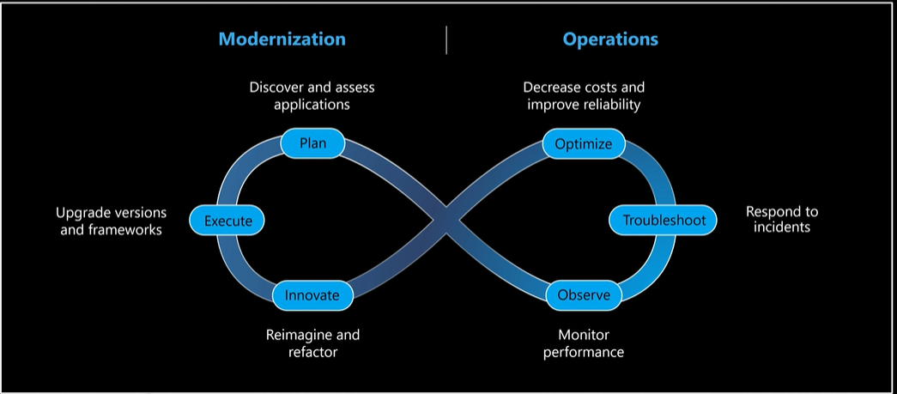

# Using AI Tools to Teach Old Apps New Tricks

## Why Modernization Matters Now

- Modernization is not new.
- With AI in the picture, modernization is more urgent than ever.
- 94% of IT leaders rank application modernization as a top priority.
- Over one-third of modernization projects stall because resources are tight, monoliths are complex, security concerns are high, and technical debt is significant.
- This eats into time that could be spent on AI-ready work.

## Modernization Is a Means, Not the End

- Modernization by itself is not the goal.
  - It is what modernization unlocks that matters.
  - Getting there is the blocker.
  - Teams are turning to agents to cut through manual work, keep efforts secure, and manage complexity.

## Why Agents for Modernization

- Agents target the pain points that slow organizations down.
- Core themes: scale, customization, and governance.
  - Scale: modernize more than one app at a time, from assessment to migration plan, with parallel execution.
  - Customize: every app is different and needs specific objectives and treatment.
  - Governance: ensure modernization happens safely with human-in-the-loop review, policies, compliance roles, and auditing.

## Build Agents Where Teams Already Work

- Build agents natively in the workloads and tools teams already use.
  - Work where you work: VS Code, Visual Studio, IntelliJ, and CLI.
  - Build with any workload: take a holistic estate-level approach across apps, data, and infrastructure.
  - Customize and govern your tools: add custom skills and rulebooks on top.

## Modernization Should Be Continuous, Intelligent, and Collaborative

- Use Azure Copilot and GitHub Copilot together as an end-to-end agentic modernization solution.
- Azure Copilot supports IT operations in the Azure portal.
- Planning approach includes 6R-aligned wave planning.
- CAF and WAF are baked in.
- Lifecycle loop: plan -> execute -> innovate -> observe -> troubleshoot -> optimize.
  - This is a continuous loop.
  - It is not a one-time activity.
- GitHub Copilot supports developers and architects in the CLI and editor.
  - This is where actual code modernization happens.

## Continuous Agentic Modernization

### Modernization Side

- **Azure Copilot Migration Agent**: IT-led entry point for:
  - Planning
  - Discovery
  - Dependency mapping
  - Business cases
  - 6R wave planning
- **GitHub Copilot** drives:
  - Execution
  - Assessing apps
  - Assessing code
  - Upgrading frameworks
  - Containerizing workloads
  - Deploying to Azure
  - Refactoring and reimagining apps for AI readiness

### Operations Side

- Keeps your apps healthy.
- Observability
- Incident response
- Cost and performance optimization
- Security woven throughout: CVE scanning, detection, and remediation

## Agents Built for Every Stage

- GitHub Copilot modernization provides an end-to-end agentic modernization system.
- Focus areas: scale, customization, and governance.
- Modernization agent: scale assessments and upgrades across the portfolio.
- Custom skills: customize and repeat tasks (specific migration patterns, write once and reuse at scale).
- Command center and rulebooks: oversee and govern work to bake in policy, with human-in-the-loop control and full auditability.
- Available everywhere.
- aka.ms/ghcp-modernization

## Demo

- Demo
- Terminal green-screen application built on COBOL.
- Mainframe modernization is now included (Private Preview).

### Steps

- Open CLI.
- Type in `Modernize`.
  - **Stage 1: Assess application** -> identify missing dependencies, highlight problems, and document the mainframe application (understand what is happening).
    - Provides an overview of the application.
    - User personas
    - Functional modules and key capabilities
    - Architecture
    - User journeys
    - Key business processes
  - End-to-end holistic level + more detailed program level (ins and outs of the application).
  - Visualization
  - **Stage 2: Modernize data layer** ->
    - Report to map data in mainframe to SQL equivalents.
  - **Stage 3: Application transformation** ->
    - Built-in knowledge and context
    - Native implementation of the application

### GitHub Modernization Agent (Single App)

- Already in VS Code.
- Can run assessments.
- Can handle runtime or framework upgrades.
- Cloud-native path -> migrate to Azure.
- Security scans
- Works for a single app.

### GitHub Modernization Agent (At Scale)

- GitHub Modernization Agent in CLI.
- Now GA.
- Needs a `repos.json` file.
- In file: `{"name": "URL"}`
- Multiple applications
- Can choose models -> best for scenario.
- Or use default model selection to get the most value.
- Assess -> add configuration file -> add repo URL.
- Can choose which assessments to run.
- Upgrade, cloud readiness, and security
- Can choose analysis coverage -> from issues-only to full.
- Can make further changes such as:
  - Runtime to use (Java or .NET)
  - Cloud readiness targets
  - Cloud compute service
  - OS
- Can assess locally or delegate to cloud agents.
  - Agents work in parallel at scale.
  - Supports headless execution.
- Can go into GitHub Agent HQ to see agents working in parallel.
- Analysis is in depth.
- Speeds up work that can otherwise take months.

### Modernization from On-Premises

- Can start assessment and discovery from on-premises environments.
- Now supports a seamless handover from Azure Migrate to GitHub Copilot Modernization Agent.
- Produces a config file with more information.
- Can push back into Azure Migrate.
- Produces an HTML report at the end, including:
  - Cost estimates based on Azure retail pricing
  - Portfolio overview
  - Effort distribution by application

### Command Center

- Self-hosted portal
- Dashboard to see where modernization stands and provide visibility
- Project timeline

### Rulebooks (Private Preview)

- Encode policy and guardrails.
- Can create in Command Center or Modernize CLI.
- Written in Markdown file format.
- Write rules, policy, and guardrails.
- Has a Charter, Policies, and Targets.
- Hard guardrails
- When you create a plan, all of this is observed.
- Can execute plan in 3 different modes:
  - Manual: code transformation is in your control; creates GitHub issues, stages changes in branches, and keeps full control in your hands.
  - Local
  - Cloud agent
- Guidelines apply regardless of language.

### Customization

- Custom skills
- Customize to your organization.
- Central repository where all organization skills live.
- Can search this repository to identify skills created in the organization.

## .NET demo
with old .aspx file

- flow mode
  - minimal prompts
- Runs in a new branch
- Executes end to end