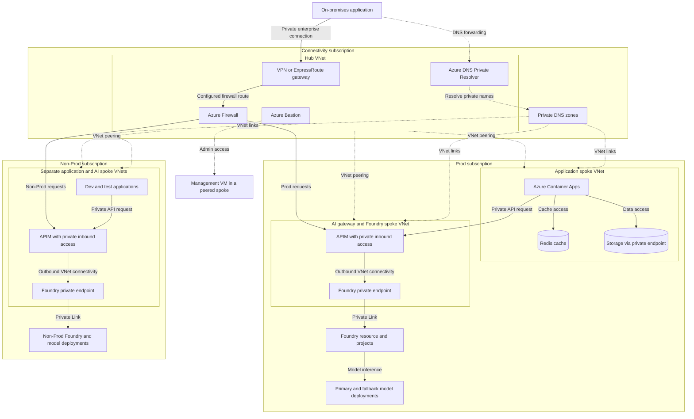
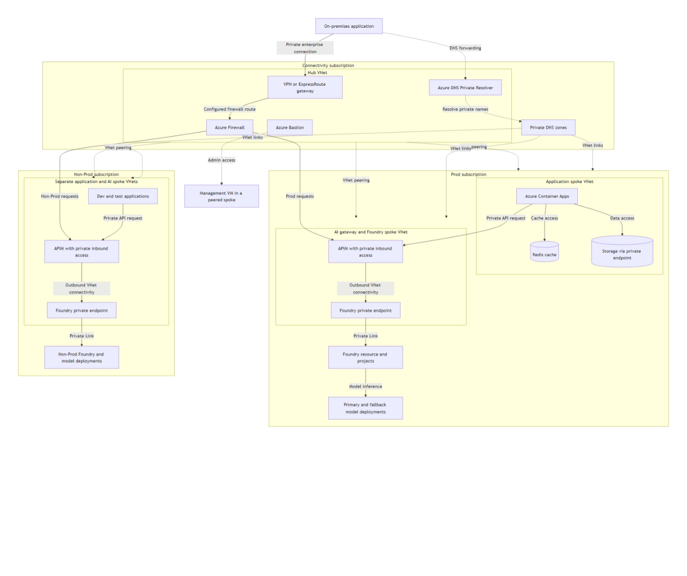
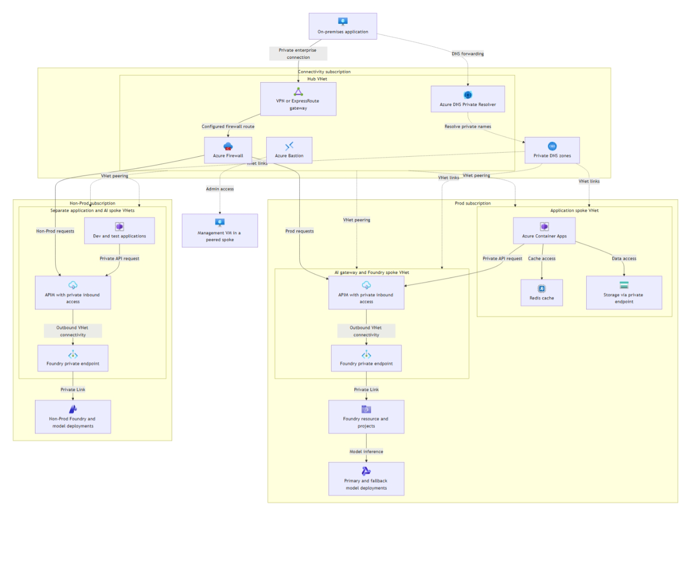
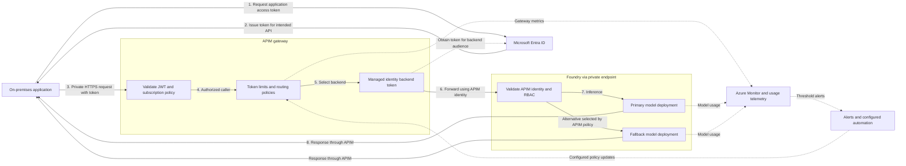
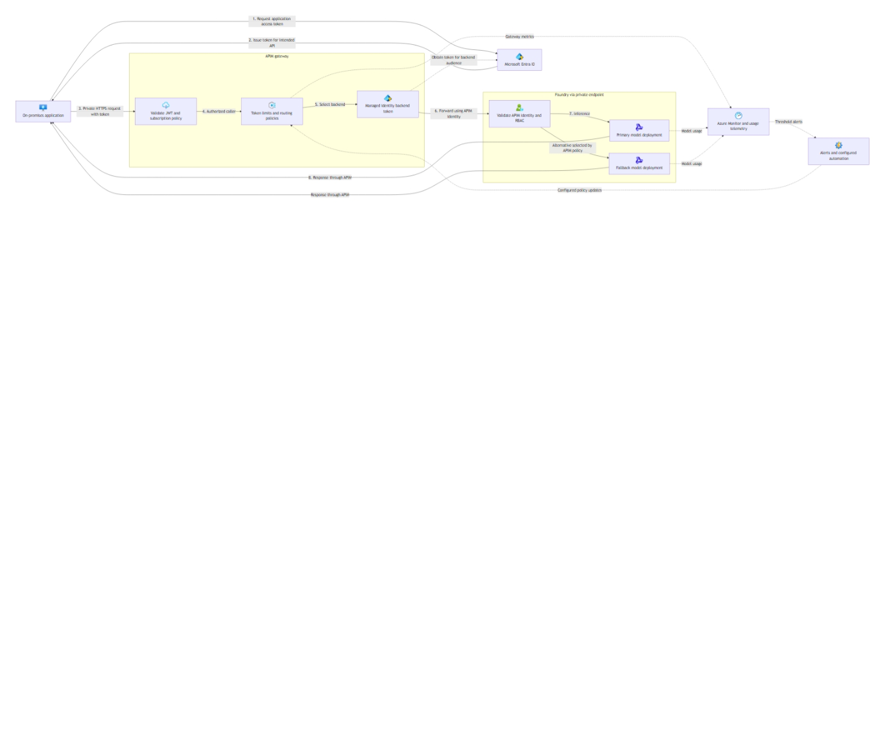

# Designing an AI Landing Zone in Azure: Governing Agents at Enterprise Scale

Over the past few months, I have been working more and more on AI workloads. One pattern keeps showing up in my conversations with customers: they are no longer asking "can we build an agent?" They are asking "how do we govern agents, and how do we control them at an enterprise level?"

So I decided to write down what I have been seeing. This post covers some of the things I have seen work, and a few that did not. It is not a definitive guide, and I would love to hear how you are approaching the same problems. Think of it as the start of an open discussion about designing an enterprise-scale foundation for AI applications and agents, and why that foundation matters.

## Why an AI landing zone matters

An AI landing zone is an enterprise-scale, production-ready foundation for deploying secure and resilient AI applications and agents in Azure. Many customers adopt one because it answers the governance question before it becomes a problem, rather than after.

The reference architecture can be implemented through the Azure portal, Bicep, or Terraform, so you can pick the tooling your team already knows. It also supports different AI use cases, scenarios, and workload patterns. You can deploy it as part of a broader platform landing zone, or on its own if your AI workloads are not yet part of a wider platform.

## The reference architecture

When you strip the architecture back to its essentials, it comes down to two key services: an AI gateway and Microsoft Foundry.

### The AI gateway with API Management

Azure API Management (APIM) acts as a centralised AI gateway and model hub. Every request to a model passes through it, which gives you one consistent layer for:

* Security
* Routing
* Monitoring
* Policy enforcement

It governs access to both production and non-production models, and it can integrate with Microsoft Foundry capabilities such as the model catalog, agents, and evaluations.

### Microsoft Foundry

Microsoft Foundry is the second piece. You deploy it as a spoke where teams build and run their agents.

Many customers create multiple Foundry deployments, one for each business unit or use case, with every deployment consuming models through the shared AI gateway. That way, each team gets its own space while the organisation keeps a single point of control.

If you do not need a centralised model hub, you can also deploy Foundry independently. Configurable deployment templates help you create consistent environments faster, while still letting each workload meet its own requirements.

## Build a design checklist

When you design an AI landing zone, think about the complete platform and not only the AI models. A model on its own is a small part of what it takes to run AI safely in production. A good checklist covers:

* Security
* Identity
* Compute
* Data
* Reliability
* Networking
* Governance
* Monitoring
* Cost optimisation
* Platform automation
* Resource organisation
* Operational excellence
* Performance efficiency

Some of these will look familiar. The Azure Well-Architected Framework groups the quality of a solution into five pillars: Reliability, Security, Cost Optimisation, Operational Excellence, and Performance Efficiency. The remaining items on the checklist cover the wider platform capabilities you need to operate AI workloads at scale. Together, they make up an enterprise-ready architecture.

### Think in terms of the AI workload lifecycle

It also helps to picture an AI workload as a flow that runs from raw data all the way to the final client:

1. Connect to data sources.
2. Ingest the data.
3. Store and govern the data.
4. Process and prepare the data.
5. Train or fine-tune models when required.
6. Ground models with retrieval-augmented generation (RAG).
7. Serve the models for inference.
8. Deliver the inference results to applications, agents, and users.

Each stage has its own security, cost, and governance questions. Walking through them in order is a good way to spot gaps before they reach production.

## Implementing AI across a large organisation

The goal is not only to introduce AI. It is to create measurable value for people and business processes. The solution has to stay secure, run efficiently, make use of the organisation's existing skills and data, and remain within budget.

Infrastructure alone will not get you there. I also encourage customers to consider:

* Data ownership, quality, privacy, and governance
* Shared infrastructure and reusable platform services
* Collaboration between business, data, security, platform, and application teams
* Skills development and clear operating responsibilities
* Cost controls and measurable business outcomes

> [!IMPORTANT]
> An AI landing zone gives you a governed foundation for moving from trusted data to secure, scalable AI applications and agents.

## A Foundry production architecture

Let's make this concrete. Imagine a customer with both an on-premises environment and Azure. I would start with a hub-and-spoke design, and the aims would be to:

* Connect the two environments privately
* Keep production separate from development and testing
* Use APIM to govern access to Foundry

### Architecture overview

The diagram below shows the shared connectivity hub and the separate Prod and Non-Prod spokes. Solid arrows show request paths or service access. Dotted arrows show network peering, DNS support, or administration, and not model requests.

<!-- mermaid-checked: no \n, no em-dash/en-dash, no {} in labels, subgraphs are id["label"], arrows are -->|"label"|, all subgraphs closed by end, ids unique -->

A few details are worth calling out so the diagram is not misread:

* The Foundry resource is not deployed inside the VNet. Its private endpoint is.
* The Non-Prod application resources are grouped together to keep the diagram readable.
* APIM networking depends on the tier you select.
* VNet peering alone does not force traffic through Azure Firewall, so the firewall path shown needs explicit routing.
* Bastion is for VM administration and is not part of the inference request path.

### Separate Prod and Non-Prod

It is best practice to create separate subscriptions for Prod and Non-Prod, each with its own Foundry resources and workload boundaries. This gives you better isolation, a smaller blast radius, and clearer governance.

It also reduces the noisy-neighbour risk, where development or test traffic affects production capacity such as provisioned throughput units (PTUs). One caution: separate subscriptions alone do not guarantee dedicated capacity, so you still need to check model capacity and quota boundaries.

### Start with the connectivity hub

For connectivity, create a resource group that contains the hub VNet and the shared networking resources:

* A virtual network gateway for the connection from on-premises
* Azure Firewall to control traffic
* Azure Bastion for private access to VMs without exposing their public IPs
* Private DNS zones for resolving private endpoint names
* Azure DNS Private Resolver for DNS resolution between on-premises and Azure

Plan your subnets early. The gateway, firewall, and Bastion each need their own dedicated subnet, and the Private Resolver endpoints use dedicated subnets too. Private DNS zones are different: they are linked to the VNets rather than deployed inside a subnet.

It helps to remember what each part does. The network connection carries the traffic, while DNS forwarding lets on-premises applications resolve the Azure private endpoint names. Without DNS, the private endpoints exist but nobody can find them.

### Connect the workload spokes

Once the hub is in place, create and peer the spoke VNets for Prod and Non-Prod.

For example, each environment could have a resource group for Foundry and APIM, with private endpoints providing access to the Foundry service. Remember that the Foundry resource and its projects are not themselves deployed into a subnet.

You can then use another resource group and spoke for the application resources, such as Azure Container Apps (ACA), Redis, and storage accounts. These connect privately to the services they need, using VNet integration and private endpoints where supported.

APIM sits in front of Foundry as the governance layer. When you choose an APIM tier, pick one that supports the combination of inbound private access and outbound VNet connectivity that you need. Not every private networking design requires the same SKU, so avoid assuming.

### Set up identity and access

For production workloads hosted in Azure, use managed identity and role-based access control (RBAC) wherever they are supported. This keeps secrets out of your application code. There are two types of managed identity:

* System-assigned identity is tied to the lifecycle of one Azure resource
* User-assigned identity has its own lifecycle and can be reused across resources

An on-premises application cannot use managed identity directly. In that case, create an app registration in Microsoft Entra ID and use its service principal. The flow looks like this:

1. The application authenticates using a certificate or client secret.
2. Entra ID issues an access token for the intended API.
3. The application presents that token to APIM.
4. APIM validates the token and applies the caller's access policies.

For Non-Prod, key-based access can make dev and test onboarding quicker where your organisation allows it. Keys still need secure storage, rotation, and restricted access. Managed identity remains a valid option for Non-Prod as well.

One more principle: separate client authentication from backend authentication. The application authenticates to APIM, and APIM then uses its own managed identity and an assigned RBAC role to call Foundry. This means client applications never need direct permissions on the models.

### Apply governance and resilience through APIM

APIM gives you one place to apply:

* JWT validation and access policies
* Subscription key requirements where needed
* Request and token rate limits
* Logging, metrics, and tracing
* Retry, load balancing, and fallback routing

Resilience deserves special attention. Configure a backup model or deployment so that traffic can fail over if the primary one is unavailable or throttled. The alternative still needs to meet the application's quality, security, and data-location requirements, so choose it carefully.

### Monitor usage and control cost

Use Foundry model monitoring and APIM telemetry to track input and output tokens, then break the usage down by application or team. This is how you answer the question "who is spending what?"

The capacity model you choose matters here:

* PTUs provide reserved model capacity for stable or high demand
* Pay-as-you-go capacity is more flexible, but spending varies with usage

Use the usage data to plan and adjust your spending controls:

* Per-app token quotas aligned with budgets
* Token-per-minute throttles
* Budget alerts and automated actions
* Routing to a cheaper or backup model where suitable

Monitoring does not enforce any of these controls by itself. You need APIM policies and, where required, automation to turn thresholds into actions. Token quotas also need to account for the different input and output prices across models.

### The end-to-end request flow

The next diagram follows a single request through the system. It separates the application token from APIM's backend identity, which is the part people most often mix up. It expands the Prod request path shown earlier, and Non-Prod follows the same pattern when Entra authentication is used.

<!-- mermaid-checked: no \n, no em-dash/en-dash, no {} in labels, subgraphs are id["label"], arrows are -->|"label"|, all subgraphs closed by end, ids unique -->

A few notes on reading this diagram:

* The response arrows summarise the return path through APIM, not a direct connection from Foundry to the app.
* Fallback routing is an APIM decision.
* Telemetry only changes policies when you configure automation to do so.
* Entra token acquisition is separate from the private inference network path.

### Walking through the request step by step

For the on-premises application example, here is what happens from start to finish:

1. The app requests an Entra access token using its configured credentials.
2. The app sends a request to APIM over the private enterprise connection.
3. The app includes the access token as a bearer token in the HTTP request header.
4. APIM validates the token and checks any required subscription key.
5. APIM applies rate limits, routing, and other governance policies.
6. APIM obtains a backend access token using its managed identity and forwards the request to Foundry over private connectivity.
7. Foundry validates APIM's identity and RBAC permissions for the target model.
8. The response returns through APIM to the app, and usage telemetry is collected for monitoring and cost tracking.

## Wrapping up

An AI landing zone is not a single service you switch on. It is a set of decisions: how you connect networks, who gets to call which model, how you separate environments, and how you keep an eye on cost. APIM and Foundry sit at the centre, and the rest of the platform wraps around them.

If you are starting out, my advice is to begin small. Set up the hub, one Prod spoke, and one Non-Prod spoke, then put APIM in front of Foundry and get the identity flow working end to end. You can add fallback models, token quotas, and automation once the foundation is solid.

I would love to hear what has worked for you, and what has not. What are you seeing in your own organisation when it comes to governing AI agents?
