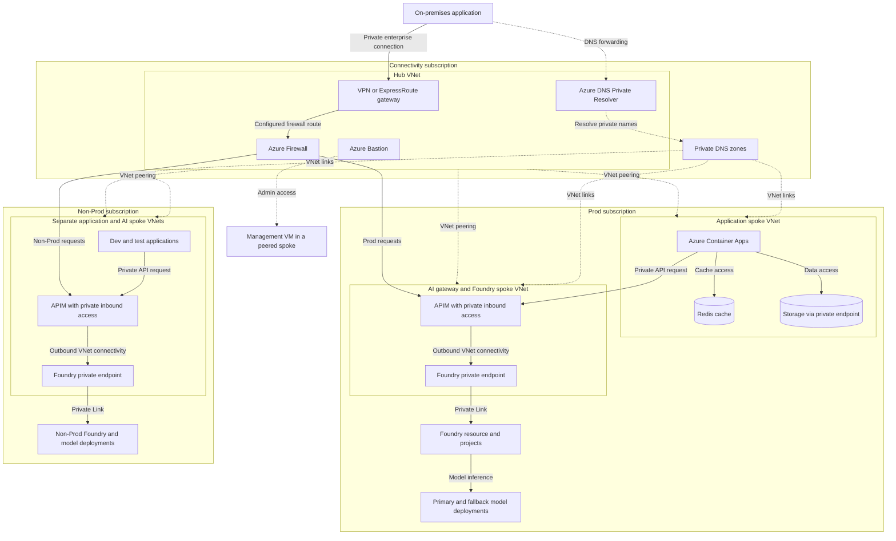
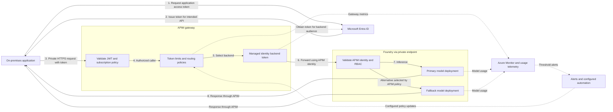

## Intro

Over the past few months ive been working more on AI workloads and have seen an increase in customers focusing on governece for Agents and having a way to controll this on an enterprise level. So i decided to take some notes, write down my findings and essentially have an open discussion with the auidence , highlighting somethings i have seen work and not work . By no means is this a definitive guide but rather a glimpse into designing and importance of an enterprise-scale foundation for AI applications and agents

## Importance of an AI landing zone

Many customers use an AI landing zone as an enterprise-scale, production ready foundation for deploying secure and resilient AI applications and agents in Azure. The reference architecture can be implemented through the Azure portal, Bicep, or Terraform. It supports different AI use cases, scenarios, and workload patterns. Customers can deploy it as part of a broader platform landing zone or use it independently.

## Reference architecture

Fundamentally the architecture for this boils down to 2 key services an AI gateway and foundry.

### AI gateway with API Management

Customers can deploy Azure API Management as a centralized AI gateway and model hub. It governs access to both production and non-production models while providing a consistent layer for security, routing, monitoring, and policy enforcement. The gateway can integrate with Microsoft Foundry capabilities such as the model catalog, agents, and evaluations.

### Microsoft Foundry

Customers can then deploy Microsoft Foundry as a spoke for building and running agents. Creating multiple Foundry deployments for different business units or use cases, with each deployment consuming models through the shared AI gateway. If they do not need a centralized model hub, customers can also deploy Foundry independently. Configurable deployment templates help create consistent environments faster while still allowing each workload to meet its own requirements.

## Design checklist

When designing an AI landing zone, it is best practise to consider the complete platform rather than only the AI models. A recommended checklist includes:

* Security
* Identity
* Compute
* Data
* Reliability
* Networking
* Governance
* Monitoring
* Cost optimization
* Platform automation
* Resource organization
* Operational excellence
* Performance efficiency

The Azure Well-Architected Framework groups the architectural quality of the solution into five pillars: Reliability, Security, Cost Optimization, Operational Excellence, and Performance Efficiency. The other checklist items cover the wider platform capabilities needed to operate AI workloads at scale. Togethere this create are eneterprise ready architecture.

### AI workload lifecycle

It is also beneficial to think about the AI workload as a flow from data to the final client:

1. Connect to data sources.
2. Ingest the data.
3. Store and govern the data.
4. Process and prepare the data.
5. Train or fine-tune models when required.
6. Ground models with retrieval-augmented generation (RAG).
7. Serve the models for inference.
8. Deliver the inference results to applications, agents, and users.

## Implement AI across a large organization

The goal is not only to introduce AI, but to create measurable value for people and business processes. The solution must remain secure, operate efficiently, use the organization's existing skills and data, and stay within budget.

Successful adoption requires more than infrastructure. I also urge customers to consider:

* Data ownership, quality, privacy, and governance
* Shared infrastructure and reusable platform services
* Cross-functional collaboration between business, data, security, platform, and application teams
* Skills development and clear operating responsibilities
* Cost controls and measurable business outcomes

> **Key takeaway:** An AI landing zone gives a governed foundation for moving from trusted data to secure, scalable AI applications and agents.

## Foundry production architecture

For a customer with both an on-premises environment and Azure, I would start with a hub-and-spoke design. The aim is to connect the environments privately,keep production separate from development and testing, and use APIM to govern access to Foundry.

### Architecture overview

The layout below shows the shared connectivity hub and the separate Prod and Non-Prod spokes. Solid arrows show request paths or service access. Dotted arrows show network peering, DNS support, or administration, not model requests.

<!-- mermaid-checked: no \n, no em-dash/en-dash, no {} in labels, subgraphs are id["label"], arrows are -->|"label"|, all subgraphs closed by end, ids unique -->

Foundry resources sit inside the VNet; their private endpoints sit inside it.
The Non-Prod application resources are grouped to keep the diagram readable. APIM networking depends on the selected tier. VNet peering alone does not force traffic through Azure Firewall, so the firewall path shown needs explicit routing. Bastion is for VM administration and is not part of the inference request path.

### Separate Prod and Non-Prod

It is best practise to create separate subscriptions for Prod and Non-Prod, with your own Foundry resources and workload boundaries. This gives better isolation, a smaller blast radius, and clearer governance.

It also helps reduce noisy-neighbour risk, where development or test traffic affects production (PTUs). Customers would still need to check model capacity and quota boundaries, because separate subscriptions alone do not guarantee dedicated capacity.

### Start with the connectivity hub

For connectivity, customers can create a resource group containing the hub VNet and the shared networking resources:

* A virtual network gateway for the connection from on-premises
* Azure Firewall to control traffic
* Azure Bastion for private access to VMs without exposing their public IPs
* Private DNS zones for resolving private endpoint names
* Azure DNS Private Resolver for DNS resolution between on-premises and Azure

The gateway, firewall, and Bastion each need their own dedicated subnet. Private Resolver endpoints also use dedicated subnets. Private DNS zones are linked to the VNets; they are not deployed inside a subnet.

The network connection carries the traffic, while DNS forwarding allows on-premises applications to resolve the Azure private endpoint names.

### Connect the workload spokes

Once the hub is in place, customers can create and peer the spoke VNets for Prod and Non-Prod.

For example, each environment could have a resource group for Foundry and APIM, with private endpoints providing access to the Foundry service. The Foundry resource and projects are not themselves deployed into a subnet.

Customers can then use another resource group and spoke for the application resources,such as Azure Container Apps (ACA), Redis, and storage accounts. These connect privately to the services they need, using VNet integration and private endpoints where supported.

APIM sits in front of Foundry as the governance layer. Customers sould choose an APIM tier that supports the required combination of inbound private access and outbound VNet connectivity, rather than assuming every private networking design requires the same SKU.

### Set up identity and access

For production workloads hosted in Azure, Customers should use managed identity and RBAC where supported. This avoids embedding secrets in the application.

The distinction between the two managed identity types is:

* System-assigned identity is tied to the lifecycle of one Azure resource
* User-assigned identity has its own lifecycle and can be reused across resources

For an on-premises application that cannot use managed identity directly, customers can create an app registration in Entra ID and use its service principal:

1. The application authenticates using a certificate or client secret.
2. Entra ID issues an access token for the intended API.
3. The application presents that token to APIM.
4. APIM validates the token and applies the caller's access policies.

For Non-Prod, key-based access can make dev/test onboarding quicker where it is allowed. Keys still need secure storage, rotation, and restricted access. Managed identity remains an option for Non-Prod too.

Customers should also separate client authentication from backend authentication. The app authenticates to APIM, while APIM can use its own managed identity and assigned RBAC role to call Foundry.

### Apply governance and resilience through APIM

APIM gives customers one place to apply:

* JWT validation and access policies
* Subscription key requirements where needed
* Request and token rate limits
* Logging, metrics, and tracing
* Retry, load balancing, and fallback routing

Customers should configure a backup model or deployment so traffic can fail over if the primary one is unavailable or throttled. The alternative still needs to meet the application's quality, security, and data-location requirements.

### Monitor usage and control cost

Customers can use Foundry model monitoring and APIM telemetry to track input and output tokens, then break down usage by application or team.

The capacity choice also matters:

* PTUs provide reserved model capacity for stable or high demand
* Pay-as-you-go capacity is more flexible, but spending varies with usage

Customers should use the usage data to plan and adjust spending controls:

* Per-app token quotas aligned with budgets
* Token-per-minute throttles
* Budget alerts and automated actions
* Routing to a cheaper or backup model where suitable

Monitoring does not enforce these controls by itself. You would need APIM policies and, where required, automation to turn thresholds into actions. Token quotas also need to account for different input and output prices across models.

### End-to-end request flow

This diagram separates the application token from APIM's backend identity.
It expands the Prod request path above; Non-Prod follows the same pattern when
Entra authentication is used.

<!-- mermaid-checked: no \n, no em-dash/en-dash, no {} in labels, subgraphs are id["label"], arrows are -->|"label"|, all subgraphs closed by end, ids unique -->

The response arrows summarize the return path through APIM, not a direct
connection from Foundry to the app. Fallback routing is an APIM decision.
Telemetry only changes policies when customers configure automation to do so.
Entra token acquisition is separate from the private inference network path.

For the on-premises application example, the flow would be:

1. The app requests an Entra access token using its configured credentials.
2. It sends a request to APIM over the private enterprise connection.
3. App sends HTTP request with Bearer access token in header.
4. APIM validates the token and checks any required subscription key.
5. APIM applies rate limits, routing, and other governance policies.
6. APIM obtains a backend access token using its managed identity and forwards
   the request to Foundry over private connectivity.
7. Foundry validates APIM's identity and RBAC permissions for the target model.
8. The response returns through APIM to the app, with usage telemetry collected
   for monitoring and cost tracking.
