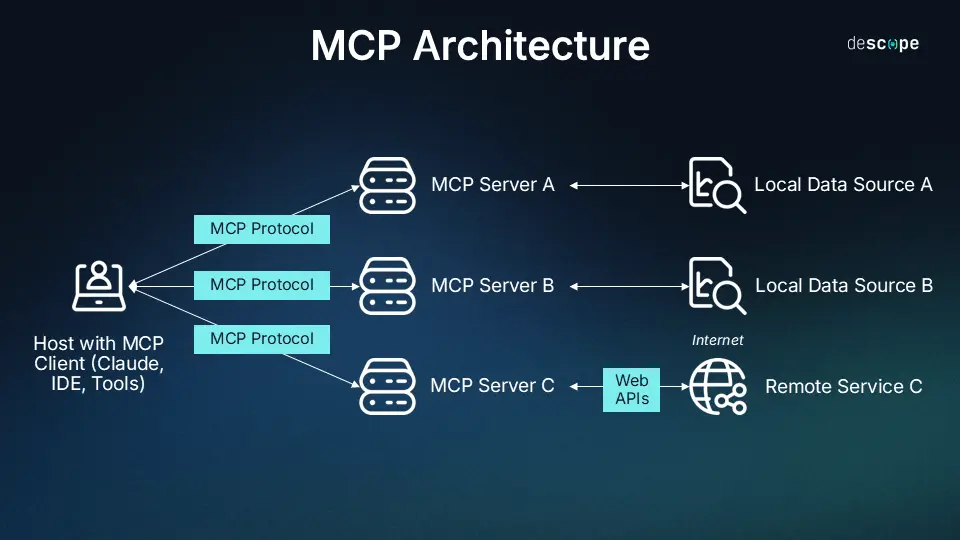

# MCP

## Intro

- Model Context Protocol (MCP) is an open protocol designed to standardize how applications provide context to large language models (LLMs).
- Can think of MCP like a USB-C port for AI applications

## Use case for Agents

- **Initial problem** : Older methods of connecting AI models with external resources often involve custom integrations for each data source or tool.
- Causing
  - **Integration Complexity**: Each new data source requires a unique implementation
  - **Scalability Issues**: Adding new tools becomes progressively harder
  - **Maintenance Overhead**: Updates to one integration may break others
- **Problem MCP solves**: solves these challenges by providing a standardized protocol
- Enables:
  - **Unified Access**: A single interface for multiple data sources and tools
  - **Plug-and-Play Extensions**: Easy addition of new capabilities
  - **Stateful Communication**: Real-time, two-way communication between AI and resources
  - **Dynamic Discovery**: AI can find and use new tools on the fly

## Demo

**Aim** : Build a MCP server with customized tools and connect to Claude Desktop and then Create an customized agent that can use external tools via MCP. Will understand how MCP can enhance our AI agents by providing them with access to the broader digital ecosystem, making them more capable.

- Will be creating a create a cryptocurrency price lookup service using the CoinGecko API
- Our server will provide tools that allow an AI to check the current price or market data of cryptocurrencies

### Architecture

- MCP follows a client-server architecture with
- Three main components:
  - **Host**: The AI application (like Claude Desktop, Cursor or a customized agent) that needs access to external resources
  - **Clients**: Connectors that maintain connections with servers
  - **Servers**: Lightweight programs that expose capabilities (data, tools, prompts) via the MCP protocol
**Data Sources**: Both local (files, databases) and remote services (APIs) that MCP servers can access


- Communication within MCP uses JSON-RPC 2.0 over WebSocket connections, ensuring real-time, bidirectional communication between components.

## Set up enviroment

1. Install uv Package Manager ```curl -LsSf https://astral.sh/uv/install.sh | sh``` use in basc cli
2. Set up Virtual enviroment ```uv init``` then ```uv venv``` with ```source .venv/Scripts/activate```
3. Install dependencies ```uv add "mcp[cli]" httpx```