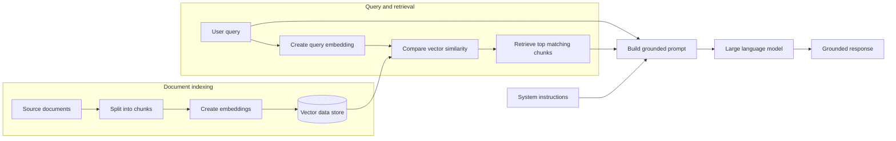

## What is RAG

Retrieval-augmented generation (RAG) gives a large language model (LLM)
relevant information so it can provide a better, more grounded response.

An LLM is trained on a fixed set of data and does not automatically know about
my private documents or the latest information. RAG addresses this limitation
by retrieving relevant content from my data source and adding it to the prompt
before the model generates a response.

## How RAG works

RAG has two main stages: indexing the documents and processing the user's
query.

### Index the documents

1. This process involves loading and split the source documents into smaller chunks.
2. An embedding model converts each chunk into a vector, which is a numerical
   representation of its meaning.
3. Users then store the document chunks and their vectors in a vector-enabled data
   store, such as Azure AI Search, Azure Cosmos DB, or PostgreSQL.

### Retrieve context and generate a response

1. The user submits a query.
2. The same embedding model converts the query into a vector.
3. The system compares the query vector with the indexed document vectors.
4. It retrieves the top matching chunks based on vector similarity.
5. The retrieved content is added to the prompt with the system instructions
   and user query.
6. The LLM uses this context to generate a grounded response.

The final request can also include settings such as temperature and a maximum
output-token limit. These settings control generation, while the retrieved
content gives the model the information it needs to answer.

## Process flow

