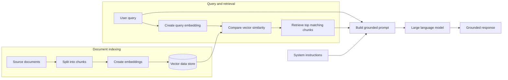

## What is RAG

Retrieval-augmented generation (RAG) gives a large language model (LLM)
relevant information so it can provide a better, more grounded response.

An LLM is trained on a fixed set of data and does not automatically know about
users private documents or the latest information. RAG addresses this limitation
by retrieving relevant content from users data source and adding it to the prompt
before the model generates a response.

To make LLMs incorporate domain knowledge : Prompt engineering; fine tuning (Learn new skills permenatley); RAG (learn new facts temporaliy)

RAG brings your data to the prompt

## How RAG works

RAG has two main stages: indexing the documents and processing the user's
query.

### Index the documents

1. This process involves loading and spliting the source documents into smaller chunks.
2. An embedding model (Text-embeding-3-large) converts each chunk into a vector (embeding), which is a numerical
   representation of its meaning. Chunking is grouping/breaking down document into smaller sections
3. User creates structure for db (Index) -> use verctor/semantic search -> create index
4. Users then store the document chunks and their vectors in a vector-enabled database, such as Azure AI Search (Unstructured Data), Azure Cosmos DB (Structured Data), Azure SQL or PostgreSQL.

### Retrieve context and generate a response

1. The user submits a query.
2. The same embedding model converts the query into a vector.
3. The system compares the query vector with the indexed document vectors.
4. It retrieves the top matching chunks based on vector similarity.
5. The retrieved content is added to the prompt with the system instructions and user query.
6. The LLM uses this context to generate a grounded response.

The final request can also include settings such as temperature and a maximum output-token limit. These settings control generation, while the retrieved content gives the model the information it needs to answer.

## Process flow

## Demo

Create the following Azure resources:

* Azure AI Search
* Microsoft Foundry
* Azure Key Vault
* Azure Storage account

Then set up and run the demo:

1. In Microsoft Foundry, create deployments for an LLM and an embedding
   model.
2. Create an index in Azure AI Search.
3. Load the source document and split it into smaller chunks.
4. Use the embedding model to create a vector for each chunk.
5. Save the chunks and their vectors in the Azure AI Search index.
6. Run the notebook to index the documents, retrieve relevant context, and
   generate a grounded response.
