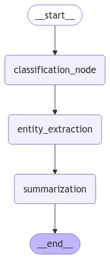

# Agents

## AI Agent

- Agents are skilled coordinators, orchestrating multiple capabilities while maintaining a holistic understanding of the task
- Making informed decisions about what to do next based on what they learns along the way
- For analyzing research papers
- **Tradditional approach**: Focuses on fragmenting the analysis into isolated steps; summarizing the paper, extracting key terms, categorizing the research type, and generating insights. Each model performs its task independently, blind to the others' findings
  - The process is rigid, predetermined, and often misses crucial connections
- AI Agent Approach: Focuses on adaptability ;  It might begin with a broad overview but can dynamically adjust its focus based on what it discovers. When it encounters significant methodological details, it can choose to analyze that section more thoroughly. If it finds intriguing references to other research, it can flag them for further investigation.
  - The agent maintains a comprehensive understanding of the paper while actively guiding its analysis based on emerging insights.
- Dynamic, context-aware approach represents the key difference between traditional AI and agents.
- Rather than executing a fixed sequence of steps, the agent acts as an intelligent guide through the analysis, making strategic decisions informed by everything it learns along the way

## Agent Architecture

- **State management**: The agent's working memory. its ability to maintain context about what it has learned and what it's trying to achieve. Agents maintain awareness of there overall task while performing specific operations.
- **Decision-making framework**: Understanding what tools and approaches are available and selecting the most appropriate ones based on the current situation
- **Use tools**: Agents ability to understand when and how to use the tools

## LangGraph

- This is a framework by LangChain for AI- agents’ workflow
- Graph based approach
- Provides the structure and tools we need to create  AI agents
- Architect's drafting table
  - It gives us the tools to design how agents will think and act
- Lets us design how different capabilities will connect and how information will flow through the agent
- Each capability the agent has is represented as a node in the graph, similiar to rooms in a building
- Connections between the nodes are called edges
- They determine how information flows from one capability to another

## Building Agent (Text Analysis sytem)

Aim: Build an agent that can analyze text documents. The agent will be able to understand what kind of text it's looking at, identify important information within it, and create concise summaries. Essentoially creating an intelligent research assistant that can help us understand documents quickly and thoroughly.

1. Set up Virtual enviroment ```python -m venv agent_env``` then ```agent_env\Scripts\activate```
2. Install needed packages ```pip install langgraph langchain langchain-openai python-dotenv```
3. Set Up  OpenAI API [Key](https://platform.openai.com/signup)
   1. Navigate to the API Keys section
   2. Create new secret key
   3. Copy  API key
4. Create .env file and store value for ```OPENAI_API_KEY```
5. build
6. For Azure repeat but  install ```pip install azure-ai-projects azure-identity'```



- Creating a coordinated workflow that determines how these capabilities work together.
- E.G. creating a production line for information processing, where each step builds on the results of the previous ones.

The structure we've created tells our agent to:

1. Start by understanding what kind of text it's dealing with
2. Then identify important entities within that text
3. Finally, create a summary that captures the main points
4. End the process once the summary is complete